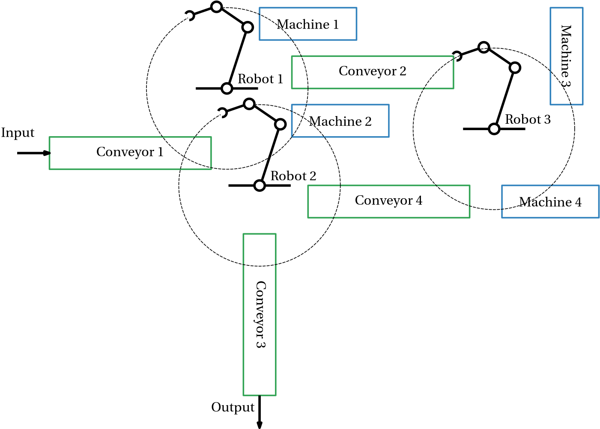

## Exercise 1: manufacturing system with multiple machines, conveyor belts and robotic arms

**Goal:** formulating a Petri net model for a manufacturing system.

Consider the manufacturing systems depicted in @fig-manufacturing. A part to be manufactured arrives by the input conveyor belt. The part is then placed to one of the two machines 1 and 3 or one of the two bidirectional conveyor belts 2 and 4 by one of the two robotic arms 1 and 2. The remaining robotic arm 3 is used to place place the parts between the two conveyor belts and and the two machines 3 and 4. The final placement of the processed part onto the output conveyor belt is only done by the robotic arm 3, which can pick up the parts from either the machine 2 and the conveyor belt 4.

{#fig-manufacturing width=80%}

The task is to model this system as a Petri net. The model should be general enough to allow for later specification of the actual processing sequences and times. The model should allow for the possibility of having multiple parts in the system at the same time.
