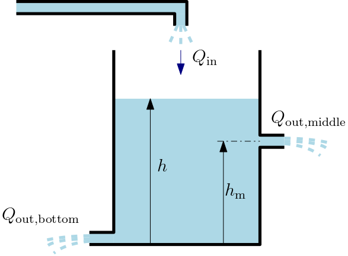
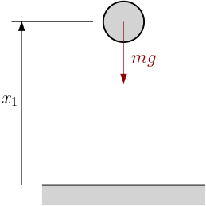
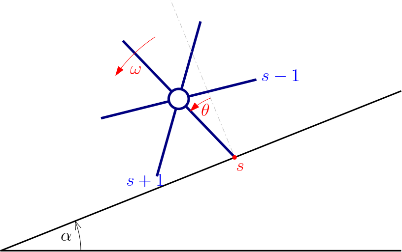
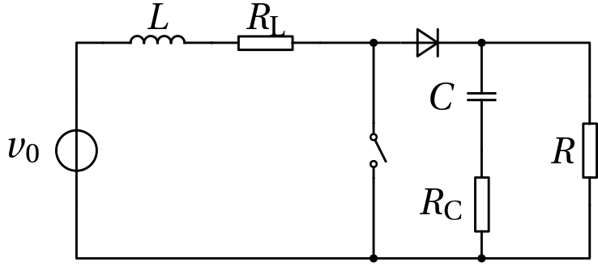
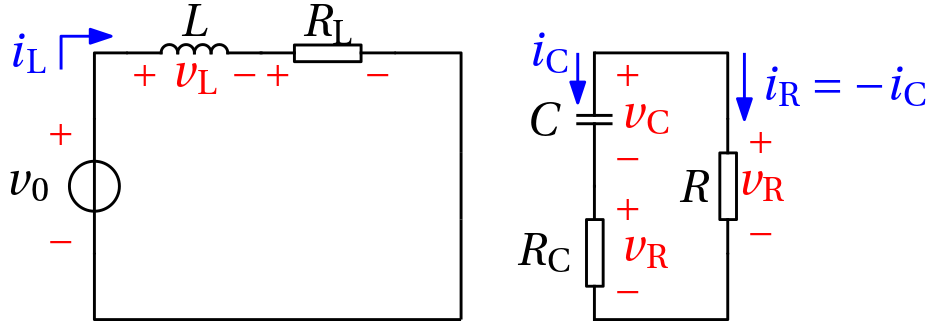
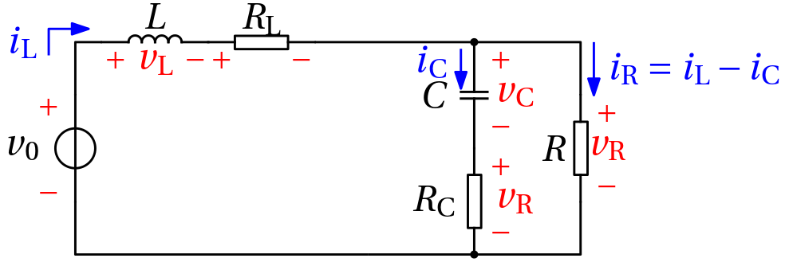
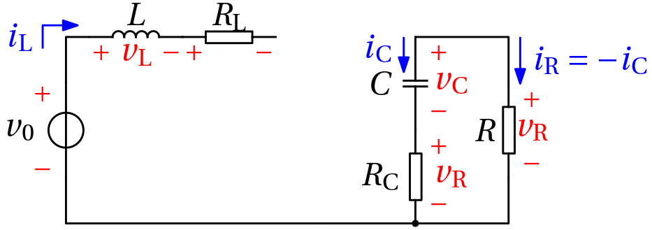
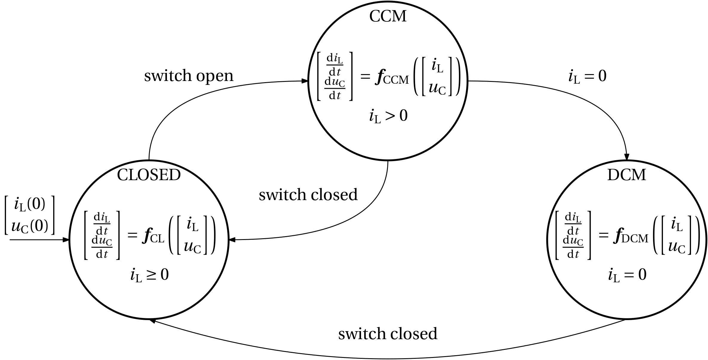

Well, here we are at last. After these three introductory topics on discrete-event systems, we'll finally get into hybrid systems.

There are two frameworks for modelling hybrid systems:

- hybrid automaton, and
- hybrid (state) equations.

Here we start with the former and save the latter for the next chapter/week. 

First we consider an *autonomous* (=no external/control inputs) *hybrid automaton* – it is a tuple of sets and (set) mappings 
$$
\boxed{
 \mathcal{H} = \{\mathcal Q, \mathcal Q_0, \mathcal X, \mathcal X_0, f, \mathcal I, \mathcal E, \mathcal G, \mathcal R\},}
$$
where 

- $\mathcal  Q$ is a set of *discrete states* (also called *modes* or *operating modes* or *locations*). 
    - Examples: 
        - $\mathcal Q = \{\text{on}, \text{off}\}$,
        - $\mathcal Q = \{\text{working}, \text{broken},\text{in repair}\}$, 
        - $\mathcal Q = \{\text{gear}\,1, \ldots, \text{gear}\,5\}$ . 
 
    - It can be characterized either by 
        - by enumeration like above, or 
        - using a state variable $q(t)$ attaining discrete values. The variable can also be a vector one, possibly a binary vector state variable encoding an integer scalar state variable. 
    
- $\mathcal Q_0\subseteq \mathcal  Q$ is a set of initial discrete states.

    - It can contain only a single element. 
        - Example: $\mathcal Q_0 = \{\text{off}\}$.
    - But if it contains more than one element, it can be used to represent uncertainty in the initial state.      

- $\mathcal X\subseteq \mathbb R^n$ is a set of continuous states. 

    - Rather than by enumeration as in the case of discrete state, it is characterized by real-valued state variables $x$, oftentimes vector ones $\bm x$. Often they are denoted $\bm x(t)$ to emphasize the evolution in time.  
    
- $\mathcal X_0\subseteq \mathcal X$ is a set of initial continuous states. 

    - A set of values of the (vector) state variable at the initial time. 
    - Often just a single initial state $\mathcal X_0=\{x_0\}$, but it can be useful to set ranges of the values of individual state variables to account for uncertainty.  
    
- $f:\mathcal{Q}\times \mathcal X \rightarrow \mathbb R^n$ is a vector field parameterized by the location

    - Often the dependence on the location $q$ expressed as $f_q(x)$ rather than the more symmetric $f(q,x)$. 
    - This defines a state equation parameterized by the location: 
    $$\dot{x}(t) = f_q(x(t)).$$
  
    - It is also possible to consider a set-valued map, replacing $f$ with 
    $$\mathcal F: \mathcal{Q}\times \mathcal X \rightarrow 2^{\mathbb R^n},$$ 
    which leads to the *differential inclusion* 
    $$\dot x \in \mathcal F_q(x).$$ 

- $\mathcal I: \mathcal Q \rightarrow 2^\mathcal{X}$ gives a (location) *invariant*. It is also called a *domain* (of the location). The latter term is perhaps more appropriate because the term invariant is already too much overloaded in the context of dynamical systems.
    
    - It is parameterized by the location.
    - It is a subset of the continuous-valued state space $\mathcal I(q) \subseteq \mathbb R^n$. 
    - It is a set of values that the state variables are allowed to attain while staying in the given location; if the state of the systems evolves towards the boundary of this set with a tendency to leave it, the system must be ready to leave that location by transitioning to another location.  

::: {.callout-caution}
Strictly speaking, $\mathcal{I}$ is a mapping and not a set. Only the mapping evaluated at a given location $q$, that is, $\mathcal{I}(q)$, is a set.
:::    

- $\mathcal E\subseteq \mathcal Q \times \mathcal Q$ is a set of *transitions*.

    - It is a set of the edges of the graph.
    - Example: $\mathcal E = \{(\text{off},\text{on}),(\text{on},\text{off})\}$, that is, a two-component set.  

- $\mathcal G: \mathcal E \rightarrow 2^\mathcal{X}$ gives a *guard set*. 

    - It is associated with a given transition. In particular, $\mathcal G(q_i,q_j)$ is the *guard set* for the transition $(q_i,q_j)\in\mathcal E$.  
    - The *guard condition* for the given transition is satisfied if $x\in \mathcal G(q_i,q_j)$. 
    - If the guard condition is satisfied, the transition is *enabled* – it may be executed. But it does not have to. 
    - The enabled transition must be executed when the state $x$ leaves the invariant set of the original location. 

- $\mathcal R: \mathcal E \times \mathcal X\rightarrow 2^{\mathcal X}$ is a *reset map*.

    - For a given transition from one location to another, it resets the continuous-valued state $x$ to a new value within some subset. 
    - Often the map is single-valued, $r: \mathcal E \times \mathcal X\rightarrow \mathcal X$ (multivalued-ness can be used to model uncertainty). 
    - We also say that the state experiences a *jump*.  
    - The state after the jump (associated with the given transition) is reset according to $x^+ = r(q_i,q_j, x)$, or $x^+ \in \mathcal R(q_i,q_j, x)$ in the multivalued case.  
    - If no resetting of the continuous-valued state takes place, the reset map is defined just as the identity operator with respect to $x$ , that is, $r(q_i,q_j, x) = x$.  

:::{.callout-caution}
## Alternative semantics for the invariant sets and guard sets
The roles of the invariant sets (the system "can stay in the given mode as long as the continuous state is within the invariant set") and the guard sets (the transition "can be executed when the continuous state is within the guard set") as we defined them constitute the most common semantics, the canonical one, there are alternative semantics used by some authors. Mostly they are motivated by the need to remove the nondeterminism that may arise when the invariant set and the guard set overlap.

- One common possibility is that as soon as the transition is enabled, it is executed, even if the state is still well inside the invariant set. In other words, a guard gives not only necessary but also sufficient conditions for the transition. Within timed automata theory, such transitions are called *eager* or *urgent*. This approach is followed by Stateflow software, for example.
- Another possibility is that even if the transition is enabled, it is only executed once the state leaves the invariant set.
:::

::: {#exm-thermostat}
## Thermostat – the hello world example of a hybrid automaton

The thermostat is a device that turns some heater `on` or `off` (or sets some valve open or closed) based on the sensed temperature. The goal is to keep the temperature around, say, $18^\circ$ C.

Naturally, the discrete states (modes, locations) are `on` and `off`. Initially, the heater is `off`. We can identify the first two components of the hybrid automaton:
$$\mathcal Q = \{\text{on}, \text{off}\}, \quad \mathcal Q_0 = \{\text{off}\}$$

The only continuous state variable is the temperature. The initial temperature is not quite certain, say, it is known to be in the interval $[18,22]$. Two more components of the hybrid automaton follow: 
$$\mathcal X = \mathbb R, \quad \mathcal X_0 = \{x:x\in \mathcal X, 18\leq x\leq 22\}$$

In the two modes `on` and `off`, the evolution of the temperature can be modelled by two different ODEs. Either from first-principles modelling or from system identification (or preferrably from the combination of the two) we get the two differential equations, say:
$$
f_\text{off}(x) = -0.1x,\quad f_\text{on}(x) = -0.1x + 5,
$$
which gives another component for the hybrid automaton.

The control logic of the thermostat is captured by the $\mathcal I$ and $\mathcal G$ components of the hybrid automaton. Let's determine them now. Obviously, if we just set 18 as the threshold, the heater would be switching on and off all the time. We need to introduce some hysteresis. Say, keeping the temperature within the interval $(18 \pm 2)^\circ$ C is acceptable. Then we can set
$$
\mathcal I(\text{off}) = \{x\mid x> 16\},\quad \mathcal I(\text{on}) = \{x\mid x< 20\},
$$  

$$
\mathcal G(\text{off},\text{on}) = \{x\mid x\leq 16\},\; \mathcal G(\text{on},\text{off}) = \{x\mid x\geq 20\}.
$$  

Apparently, the guard sets are complementary to the invariant sets of the corresponding modes, which is a common choice to make the model deterministic.

Finally, $\mathcal R$ (or $r$) is not specified as the $x$ variable (the temperature) doesn't jump. Well, it is specified implicitly as an identity mapping $r(x)=x$.

The graphical representation of the thermostat hybrid automaton is shown in @fig-thermostat-automaton.

{width=60% #fig-thermostat-automaton}

The code implementing this hybrid automation and simulation of its response to a given initial state in Julia is below. It uses the [MathematicalSystems.jl](https://juliareach.github.io/MathematicalSystems.jl/stable/), [HybridSystems.jl](https://blegat.github.io/HybridSystems.jl/stable/index.html) and [LazySets.jl](https://juliareach.github.io/LazySets.jl/stable/) packages for defining a hybrid automaton, and [OrdinaryDiffEq.jl](https://docs.sciml.ai/DiffEqDocs/stable/) for solving the corresponding ODEs.

First, we define the automaton:
```{julia}
#| code-fold: show
using HybridSystems, MathematicalSystems, LazySets, OrdinaryDiffEq

function thermostat_automaton(; T_on_max=20.0, T_off_min=16.0, T_guard_on2off=20.0, T_guard_off2on=16.0)
    automaton = GraphAutomaton(2)                       # Locations: 1 = on, 2 = off
    add_transition!(automaton, 1, 2, 1)                 # Transition 1: on -> off
    add_transition!(automaton, 2, 1, 2)                 # Transition 2: off -> on

    # Flows and invariants. A halfspace {x | a'x ≤ b} is given as HalfSpace(a, b).
    mode_on = @system(x' = -0.1*x + 5.0, x ∈ HalfSpace([1.0], T_on_max), dim=1)     # x ≤ T_on_max
    mode_off = @system(x' = -0.1*x, x ∈ HalfSpace([-1.0], -T_off_min), dim=1)        # x ≥ T_off_min
    modes = [mode_on, mode_off]

    # Guards (and identity reset maps)
    on2off = ConstrainedIdentityMap(1, HalfSpace([-1.0], -T_guard_on2off))           # x ≥ T_guard_on2off
    off2on = ConstrainedIdentityMap(1, HalfSpace([1.0], T_guard_off2on))             # x ≤ T_guard_off2on

    return HybridSystem(automaton, modes, [on2off, off2on], [AutonomousSwitching()])
end
```

Unfortunately, the current version of the `HybridSystems.jl` does not offer anything beyond the new type definition. We implement our own solver here:

```{julia}
#| code-fold: true
using LinearAlgebra, Random, Plots

vectorfield(s::ConstrainedLinearContinuousSystem) = x -> s.A * x
vectorfield(s::ConstrainedAffineContinuousSystem) = x -> s.A * x + s.c

# Membership in a polyhedral set (given by halfspaces) with some tolerance (to tolerate numerical errors at the boundary).
isinside(x, X; tol=1e-8) = all(dot(c.a, x) <= c.b + tol for c in constraints_list(X))

guardset(H, tr) = stateset(resetmap(H, tr))

"""
    simulate(H, q0, x0, tf; semantics=:random, rng=Random.default_rng(), Δt=1e-3, maxjumps=1000)

Simulate a single execution of the hybrid automaton `H` from the initial location `q0` and the initial state `x0` on the time
interval [0, tf]. Within the location, the state flows until it is about to leave the invariant. Out of the time instants
at which some outgoing transition is enabled, the switching time is chosen according to `semantics`:

- `:eager` – the transition is executed as soon as it is enabled (urgent transitions, like in Stateflow),
- `:lazy` – the transition is executed only when the state is about to leave the invariant,
- `:random` – a time instant at which some transition is enabled is chosen (uniformly) at random.

If several transitions are enabled at the switching time, one of them is chosen at random.
Returns a vector of segments (one per visited location), each a named tuple `(q, t, x)`.
"""
function simulate(H, q0, x0, tf; semantics=:random, rng=Random.default_rng(), Δt=1e-3, maxjumps=1000)
    q, x, t = q0, float.(collect(x0)), 0.0
    segments = NamedTuple[]
    for _ in 1:maxjumps
        sys = mode(H, q)
        isinside(x, stateset(sys)) || error("The state $x at time $t is not in the invariant of the location $q.")

        # Flow within the location until the state is about to leave the invariant (or until the final time).
        f = vectorfield(sys)
        constraints = constraints_list(stateset(sys))
        condition(out, x, t, integrator) = (out .= [c.b - dot(c.a, x) for c in constraints])  # positive inside
        leaving_invariant = VectorContinuousCallback(condition, nothing, (integrator, idx) -> terminate!(integrator), length(constraints))
        sol = solve(ODEProblem((x, p, t) -> f(x), x, (t, tf)), Tsit5(); callback=leaving_invariant, abstol=1e-10, reltol=1e-10)
        t_end = sol.t[end]
        forced = t_end < tf                            # The state is about to leave the invariant before the final time.

        # Time instants (on a grid) at which some outgoing transition is enabled.
        enabled(τ) = [tr for tr in out_transitions(H, q) if isinside(sol(τ), guardset(H, tr))]
        grid = unique([collect(t:Δt:t_end); t_end])
        candidates = filter(τ -> !isempty(enabled(τ)), grid)

        # Choose the switching time (if any).
        τ = if isempty(candidates)
            forced && @warn "Blocking: no transition enabled when leaving the invariant of location $q at t = $t_end."
            nothing
        elseif semantics == :eager
            first(candidates)
        elseif semantics == :lazy
            forced ? last(candidates) : nothing
        elseif semantics == :random
            # If the final time is reached before being forced to leave, staying in the location is also an option.
            forced ? rand(rng, candidates) : rand(rng, [candidates; nothing])
        else
            error("Unknown semantics $semantics.")
        end

        t_stop = something(τ, t_end)
        ts = [filter(<(t_stop), sol.t); t_stop]
        push!(segments, (q=q, t=ts, x=sol.(ts)))
        isnothing(τ) && break

        # Jump: choose one of the enabled transitions and apply its reset map.
        tr = rand(rng, enabled(τ))
        q, x, t = target(H, tr), apply(resetmap(H, tr), sol(τ)), τ
        t >= tf && break
    end
    return segments
end

function plot_execution!(p, segments; i=1, colors=(:red, :blue), kwargs...)
    for (k, s) in enumerate(segments)
        plot!(p, s.t, getindex.(s.x, i); color=colors[s.q], label="", kwargs...)
        if k < length(segments)                         # Dashed line for the jump (if any) to the next segment.
            next = segments[k+1]
            plot!(p, [s.t[end], next.t[1]], [s.x[end][i], next.x[1][i]]; color=:gray, ls=:dash, label="", kwargs...)
        end
    end
    return p
end
```

We can now use this simulator to simulate the response of the thermostat hybrid automaton to a single initial state (temperature). The results are shown in @fig-thermostat-simulation-deterministic.

```{julia}
#| code-fold: true
#| fig-cap: Simulation of a response of a thermostat deterministic hybrid automaton to a single initial state (temperature)
#| label: fig-thermostat-simulation-deterministic
H = thermostat_automaton()
segments = simulate(H, 2, [22.0], 30.0)                 # Start in location 2 (off) at 22 °C.
p1 = plot(xlabel="Time (s)", ylabel="Temperature (°C)")
plot_execution!(p1, segments; lw=2, guidefontsize=6, tickfontsize=6, size=(400, 300))
```

Now, the presented framework allows defining the invariant and guard sets corresponding to a given mode as overlapping. For example:
$$
\mathcal I(\text{off}) = \{x\mid x> 16\},\quad \mathcal I(\text{on}) = \{x\mid x< 20\},
$$  
and
$$
\mathcal G(\text{off},\text{on}) = \{x\mid x\leq 17\},\; \mathcal G(\text{on},\text{off}) = \{x\mid x\geq 19\}.
$$

The resulting hybrid automaton is shown in @fig-thermostat-automaton-nondeterministic.

{width=60% #fig-thermostat-automaton-nondeterministic}

This clearly introduces a *nondeterminism* – the response of the system is not uniquely determined. Consider the case when the system is in the `off` mode and the temperature is 16.5. The system can either stay in the `off` mode or switch to the `on` mode. It does not seem a good idea to *program* our thermostat in this way, but it may be useful to have this modelling choice in other situations to represent uncertainty, so we keep working with this example. 

We can handle the nondeterminism due to overlapping invariant and guard sets by using a random number generator to decide whether to stay or whether to go. The responses to a few initial temperatures are shown in @fig-thermostat-simulation-nondeterministic.
```{julia}
#| code-fold: true
#| fig-cap: Simulation of a response to a range of initial states (temperatures) for a nondeterministic hybrid automaton modelling a thermostat
#| label: fig-thermostat-simulation-nondeterministic

Hnd = thermostat_automaton(T_guard_on2off=19.0, T_guard_off2on=17.0)
rng = Xoshiro(1234)
p2 = plot(xlabel="Time (s)", ylabel="Temperature (°C)", guidefontsize=6, tickfontsize=6, size=(400, 300))
for _ in 1:10
    x0 = 18.0 + 4.0 * rand(rng)                         # Initial temperature from [18, 22]
    plot_execution!(p2, simulate(Hnd, 2, [x0], 30.0; semantics=:random, rng=rng); lw=1)
end
hline!(p2, [16, 17, 19, 20]; color=:black, ls=:dot, label="")
```

But as we have already discussed, there may be different semantics for handling the overlapping of invariant and guard sets. Below we also plot the responses to a few initial temperatures for the same hybrid automaton but with the `:eager` semantics, which is shown in @fig-thermostat-simulation-eager. We also show the responses for the `:lazy` semantics for comparison. The difference is that the `:eager` semantics executes the transition as soon as it is enabled (this is how Stateflow simulator works too), while the `:lazy` semantics executes the transition only when the state is about to leave the invariant.
```{julia}
#| code-fold: true
#| fig-cap: Simulation of a response to an initial state (temperature) for a hybrid automaton modelling a thermostat with overlapping invariant and guard sets, with two different semantics for handling the nondeterminism – eager (solid line) and lazy (dash-dotted line)
#| label: fig-thermostat-simulation-eager

p3 = plot(xlabel="Time (s)", ylabel="Temperature (°C)", guidefontsize=6, tickfontsize=6, size=(400, 300))
plot_execution!(p3, simulate(Hnd, 2, [22.0], 30.0; semantics=:eager); lw=2)
plot_execution!(p3, simulate(Hnd, 2, [22.0], 30.0; semantics=:lazy); lw=2, ls=:dashdot)
```
:::

## Hybrid automaton with external events and control inputs

We now extend the hybrid automaton with two new components:
    
- a set $\mathcal{A}$ of (external) events (also actions or symbols), 
- a set $\mathcal{U}$ external continuous-valued inputs (control inputs or disturbances).

$$\boxed{
  \mathcal{H} = \{\mathcal Q, \mathcal Q_0, \mathcal X, \mathcal X_0, \mathcal I, \mathcal A, \mathcal U, f, \mathcal E, \mathcal G, \mathcal R\} ,}
$$
where 

- $\mathcal A = \{a_1,a_2,\ldots, a_s\}$ is a set of events 
    - The role identical as in a (finite) state automaton: an external event triggers an (enabled) transition from the current discrete state (mode, location) to another. 
    - Unlike in pure discrete-event systems, here they are considered within a model that does recognize passing of time – each action must be "time-stamped". 
    - In simulations such timed event can be represented by an edge in the signal. In this regard, it might be tempting not to introduce it as a seperate entity, but it is useful to do so.

- $\mathcal U\in\mathbb R^m$ is a set of continuous-valued inputs 

    - Real-valued functions of time.
    - Control inputs, disturbances,  references, noises. In applications it will certainly be useful to distinghuish these roles, but here we keep just a single type of such an external variable, we do not have to distinguish.  

### Some modifications needed

Upon introduction of these two types of external inputs we must modify the components of the definition we provided earlier:

- $f: \mathcal Q \times \mathcal X \times \mathcal U \rightarrow \mathbb R^n$ is a vector field that now depends not only on the location but also on the external (control) input, that is, at a given location we consider the state equation $\dot x = f_q(x,u)$.  

- $\mathcal E\subseteq \mathcal Q \times (\mathcal A) \times \mathcal Q$ is a set of transitions now possibly parameterized by the actions (as in classical automata).  

- $\mathcal I : \mathcal Q \rightarrow 2^{\mathcal{X}\times \mathcal U}$ is a location invariant now augmented with a subset of the control input set. The necessary condition for staying in the given mode can be thus imposed not only on $x$ but also on $u$. 

- $\mathcal G: \mathcal E \rightarrow 2^{\mathcal{X}\times U}$ is a guard set now augmented with a subset of the control input set. The necessary condition for a given transition can be thus imposed not only on $x$ but also on $u$. 

- $\mathcal R: \mathcal E \times \mathcal X\times \mathcal U\rightarrow 2^{\mathcal X}$ is a (state) reset map that is now additionally parameterized by the control input. 

:::{.callout-important}
### Alternative semantics of transitions with external events
There does not appear to be a universal agreement on the semantics of transitions in hybrid automata with external events. What we presented above is the most common one, namely, the transition occurs when the external event arrives *and* the guard condition is satisfied (the invariant set is relevant as before). However, in alternative semantics, the transition occurs as soon as the corresponding external event occurs. But as a matter of fact, this alternative semantics can be formulated within the original one by assuming that the guard condition (posibly even an unspecified one) is automatically satisfied.
:::

::: {#exm-button-controlled-LED}
## Button-controlled LED

{width=80% #fig-button-controlled-LED}

$$
\mathcal{Q} = \{\mathrm{off}, \mathrm{dim}, \mathrm{bright}\},\quad \mathcal{Q}_0 = \{\mathrm{off}\}
$$

$$
\mathcal{X} = \mathbb{R}, \quad \mathcal{X}_0 = \{0\}
$$

$$
\mathcal{I(\mathrm{off})} = \mathcal{I(\mathrm{bright})} = \mathcal{I(\mathrm{dim})} = \{x\in\mathbb R \mid x \geq 0\}
$$

$$
f(x) = 1
$$

$$
\mathcal{A} = \{\mathrm{press}\}
$$

$$
\begin{aligned}
\mathcal{E} &= \{(\mathrm{off},\mathrm{press},\mathrm{dim}),(\mathrm{dim},\mathrm{press},\mathrm{off}),\\
&\qquad (\mathrm{dim},\mathrm{press},\mathrm{bright}),(\mathrm{bright},\mathrm{press},\mathrm{off})\}
\end{aligned}
$$

$$
\begin{aligned}
\mathcal{G}((\mathrm{off},\mathrm{press},\mathrm{dim})) &= \mathcal X \\
\mathcal{G}((\mathrm{dim},\mathrm{press},\mathrm{off})) &= \{x \in \mathcal X \mid x>2\}\\
\mathcal{G}((\mathrm{dim},\mathrm{press},\mathrm{bright})) &= \{x \in \mathcal X \mid x\leq 2\}\\
\mathcal{G}((\mathrm{bright},\mathrm{press},\mathrm{off})) &= \mathcal X. 
\end{aligned}
$$

$$
r((\mathrm{off},\mathrm{press},\mathrm{dim}),x) = 0, 
$$

- that is, $x^+ = r((\mathrm{off},\mathrm{press},\mathrm{dim}),x) = 0$. 
- For all other transitions $r((\cdot, \cdot, \cdot),x)=x$, 
    - that is, $x^+ = x$.
:::

::: {#exm-water-tank}
## Water tank

We consider a water tank with one inflow and two outflows – one at the bottom, the other at some nonzero height $h_\mathrm{m}$. The water level $h$ is the continuous state variable.

{width=50% #fig-water-tank}

The model essentially expresses that the change in the volume is given by the difference between the inflow and the outflows. The outflows are proportional to the square root of the water level (Torricelli's law)
$$
\dot V = 
\begin{cases}
Q_\mathrm{in} - Q_\mathrm{out,middle} - Q_\mathrm{out,bottom}, & h>h_\mathrm{m}\\
Q_\mathrm{in} - Q_\mathrm{out,bottom}, & h\leq h_\mathrm{m}
\end{cases}
$$

Apparently things change when the water level crosses (in any direction) the height $h_\mathrm{m}$. This can be modelled using a hybrid automaton.

{width=80% #fig-water-tank-automaton}

One lesson to learn from this example is that the transition from one mode to another is not necessarily due to some computer-controlled switch. Instead, it is our modelling choice. It is an approximation that assumes negligible diameter of the middle pipe. But taking into the consideration the volume of the tank, it is probably a justifiable approximation.
:::

::: {#exm-bouncing-ball}
## Bouncing ball

We assume that a ball is falling from some initial nonzero height above the table. After hitting the table, it bounces back, loosing a portion of the energy (the deformation is not perfectly elastic). 

{width=25% #fig-bouncing-ball}

The state equation during the free fall is
$$
\dot{\bm x}(t) = \begin{bmatrix} x_2(t)\\ -g\end{bmatrix}, 
$$
while the initial state is $\bm x(0) = \begin{bmatrix}10\\0\end{bmatrix}$.

But how can we model what happens during and after the collision? High-fidelity model would be complicated, involving partial differential equations to model the deformation of the ball and the table. These complexities can be avoided with a simpler model assuming that immediately after the collision the sign of the velocity abruptly (discontinuously) changes, and at the same time the ball also looses a portion of the energy.

When modelling this using a hybrid automaton, it turns out that we only need a single discrete state. The crucial feature of the model is then the nontrivial (non-identity) *reset map*. This is depicted in @fig-bouncing-ball-automaton.

{width=50% #fig-bouncing-ball-automaton}

For completeness, here are the individual components of the hybrid automaton:
$$
\mathcal{Q} = \{q\}, \; \mathcal{Q}_0 = \{q\}
$$

$$
\mathcal{X} = \mathbb R^2, \; \mathcal{X}_0 = \left\{\begin{bmatrix}10\\0\end{bmatrix}\right\}
$$

$$
\mathcal{I} = \{\mathbb R^2 \mid x_1 > 0 \lor (x_1 = 0 \land x_2 \geq 0)\}
$$

$$
f(\bm x) = \begin{bmatrix} x_2\\ -g\end{bmatrix}
$$

$$
\mathcal{E} = \{(q,q)\}
$$

$$
\mathcal{G} = \{\bm x\in\mathbb R^2 \mid x_1=0 \land x_2 < 0\}
$$

$$
r((q,q),\bm x) = \begin{bmatrix}x_1\\ -\gamma x_2 \end{bmatrix}, 
$$
where $\gamma$ is the coefficient of restitution (e.g., $\gamma = 0.9$).

::: {.callout-warning}
## Comment on the invariant set for the bouncing ball

Some authors characterize the invariant set as $x_1\geq 0$. But this means that as the ball touches the ground, nothing forces it to leave the location and do the transition. Instead, the ball must penetrate the ground, however tiny distance, in order to trigger the transition. The current definition avoids this. 
:::

::: {.callout-note}
## Another comment on the invariant set for the bouncing ball
While the previous remark certainly holds, when solving the model numerically, the use of inequalities to define sets is inevitable. And some numerical solvers, in particular optimization solvers, cannot handle strict inequalities. That is perhaps why some authors are quite relaxed about this issue. We will encounter it later on.
:::

:::


::: {#exm-stick-slip-friction}
## Stick-slip friction model (Karnopp)

Consider a block of mass $m$ placed freely on a surface. External horizontal force $F_\mathrm{a}$ is applied to the block, setting it to a horizontaly sliding motion, against which the friction force $F_\mathrm{f}$ is acting:
$$
m\dot v = F_\mathrm{a} - F_\mathrm{f}(v).
$$

Common choice for a model of friction between two surfaces is *Coulomb friction*
$$
F_\mathrm{f}(v) = F_\mathrm{c}\operatorname*{sgn}(v).
$$

The model is perfectly intuitive, isn't it? Well, what if $v=0$ and $F_\mathrm{a}<F_\mathrm{c}$? Can you see the trouble?

One of the remedies is the Karnopp model of friction
$$
m\dot v = 0, \qquad v=0, \; |F_\mathrm{a}| < F_\mathrm{c}
$$
$$
F_\mathrm{f} = \begin{cases}\operatorname*{sat}(F_\mathrm{a},F_\mathrm{c}), & v=0\\F_\mathrm{c}\operatorname*{sgn}(v), & \mathrm{else}\end{cases}
$$

The model can be formulated as a hybrid automaton with two discrete states (modes, locations) as in @fig-karnopp-automaton. 

{width="60%" #fig-karnopp-automaton} 
:::


::: {#exm-rimless-wheel}
## Rimless wheel

A simple mechanical model that is occasionally used in the walking robot community is the rimless wheel rolling down a declined plane as depicted in @fig-rimless-wheel.

{width=50% #fig-rimless-wheel}

A hybrid automaton for the rimless wheel is below.

{width=90% #fig-rimless-wheel-automaton}

Alternatively, we do not represent the discrete state graphically as a node in the graph but rather as another – extending – state variable $s \in \{0, 1, \ldots, 5\}$ within a single location.


{width=50% #fig-rimless-wheel-automaton-single-location}
:::

::: {#exm-DC-DC-boost-converter}
## DC-DC boost converter

The enabling mechanism for a DC-DC converter is switching. Although the switching is realized with a semiconductor switch, for simplicity of the exposition we consider a manual switch in @fig-dc-dc-boost-converter below.

{width=40% #fig-dc-dc-boost-converter}

The switch introduces two modes of operation. But the (ideal) diode introduces a mode transition too.

### The switch closed

{width=50% #fig-dc-dc-boost-converter-mode-CLOSED}

$$
\begin{bmatrix}
\frac{\mathrm{d}i_\mathrm{L}}{\mathrm{d}t}\\
\frac{\mathrm{d}v_\mathrm{C}}{\mathrm{d}t}
\end{bmatrix}
=
\begin{bmatrix}
-\frac{R_\mathrm{L}}{L}i_\mathrm{L} & 0\\
0 & -\frac{1}{C(R+R_\mathrm{C})}
\end{bmatrix}
\begin{bmatrix}
i_\mathrm{L}\\
v_\mathrm{C}
\end{bmatrix}
+
\begin{bmatrix}
\frac{1}{L}\\
0
\end{bmatrix}
v_0
$$

### Continuous conduction mode (CCM)

{width=50% #fig-dc-dc-boost-converter-mode-CCM}

$$
\begin{bmatrix}
\frac{\mathrm{d}i_\mathrm{L}}{\mathrm{d}t}\\
\frac{\mathrm{d}v_\mathrm{C}}{\mathrm{d}t}
\end{bmatrix}
=
\begin{bmatrix}
-\frac{R_\mathrm{L}+ \frac{RR_\mathrm{C}}{R+R_\mathrm{C}}}{L} & -\frac{R}{L(R+R_\mathrm{C})}\\
\frac{R}{C(R+R_\mathrm{C})} & -\frac{1}{C(R+R_\mathrm{C})}
\end{bmatrix}
\begin{bmatrix}
i_\mathrm{L}\\
v_\mathrm{C}
\end{bmatrix}
+
\begin{bmatrix}
\frac{1}{L}\\
0
\end{bmatrix}
v_0
$$

### Discontinuous cond. mode (DCM)

{width=50% #fig-dc-dc-boost-converter-mode-DCM}

$$
\begin{bmatrix}
\frac{\mathrm{d}i_\mathrm{L}}{\mathrm{d}t}\\
\frac{\mathrm{d}v_\mathrm{C}}{\mathrm{d}t}
\end{bmatrix}
=
\begin{bmatrix}
0 & 0\\
0 & -\frac{1}{C(R+R_\mathrm{C})}
\end{bmatrix}
\begin{bmatrix}
i_\mathrm{L}\\
v_\mathrm{C}
\end{bmatrix}
+
\begin{bmatrix}
0\\
0
\end{bmatrix}
v_0
$$

:::{.notes}
Possibly the events of opening and closing the switch can be driven by time: opening the switch is derived from the value of an input signal, closing the switch is periodic.
:::

{width=80% #fig-dc-dc-boost-converter-automaton}

:::
