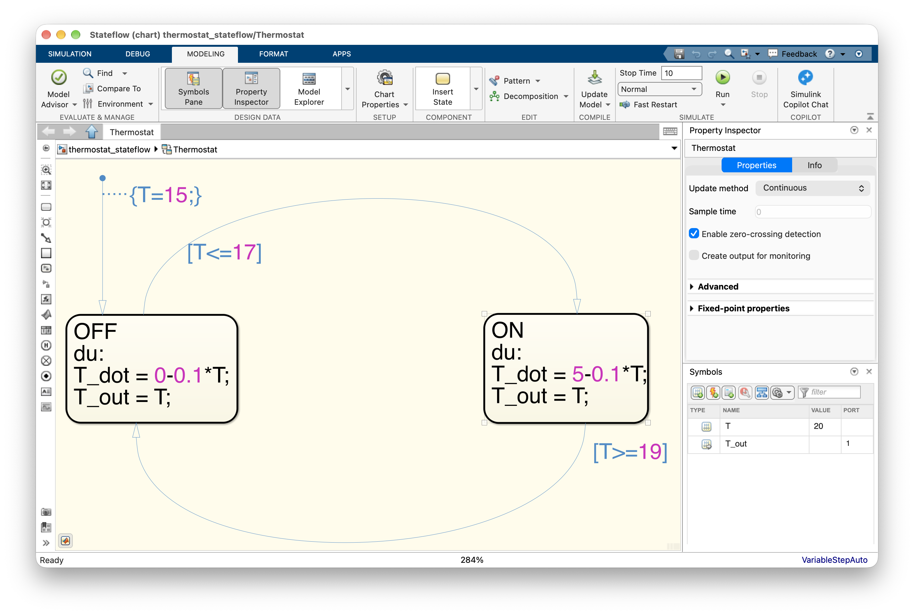

## Matlab and Simulink and Stateflow

- **pure Simulink**: we can build models of systems with hybrid dynamics using just Simulink, but then the [relational operators](https://www.mathworks.com/help/simulink/slref/relationaloperator.html) and [logical operators](https://www.mathworks.com/help/simulink/slref/logicaloperator.html) will be needed. We may also appreciate the extra options for the [integrator](https://www.mathworks.com/help/simulink/slref/integrator.html) block, such as the external reset, external initial conditions, and displaying the state port (to avoid algebraic loops if the resetting condition is derived from the integrator output).
- **pure Matlab**: we can go relatively far just with Matlab – the key functionality is [event location](https://www.mathworks.com/help/matlab/math/ode-event-location.html) while calling the ODE solvers.
- **Stateflow**: having been exposed to some basics of automata modeling in Stateflow, [including continuous-time dynamics in Stateflow](https://www.mathworks.com/help/stateflow/ug/about-continuous-time-modeling.html) is relatively straightforward. Here we only single out one potential stumbling block: we must make sure that we set the *Update method* for the whole chart to `Continuous` (open the *Property inspector* pane in the *Modeling menu*, make sure the chart is selected).

  {width=60%}

## Julia

- [HybridSystems.jl](https://github.com/blegat/HybridSystems.jl) – the package essentially just defines some basic data types, currently it is mainly used by some other packages, such as ReachabilityAnalysis.jl. 
- [ReachabilityAnalysis.jl](https://github.com/JuliaReach/ReachabilityAnalysis.jl) – well-maintained and even [award-winning](https://juliareach.github.io/post/archcomp20_prize/) (under its previous name) package that also supports hybrid systems.

## Python

- ...
