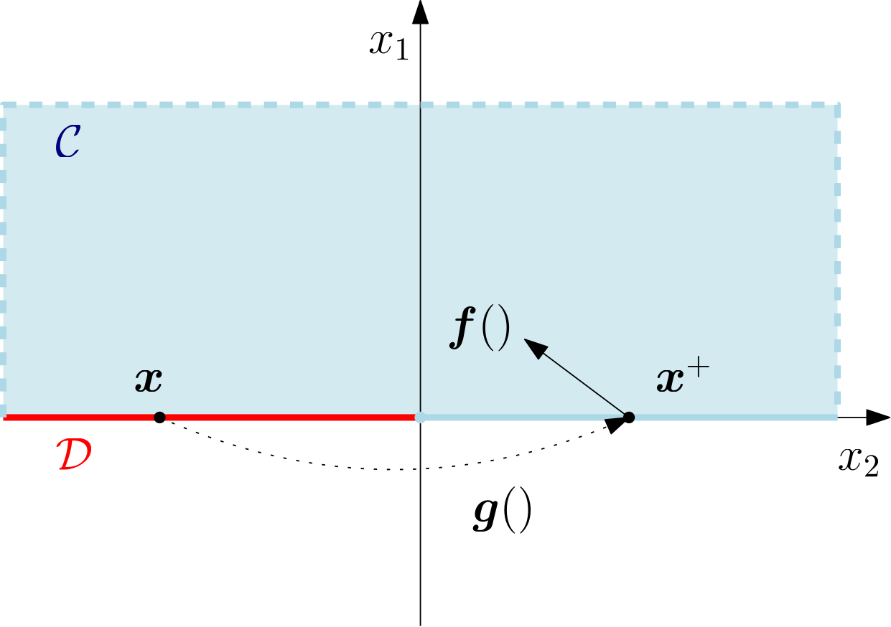
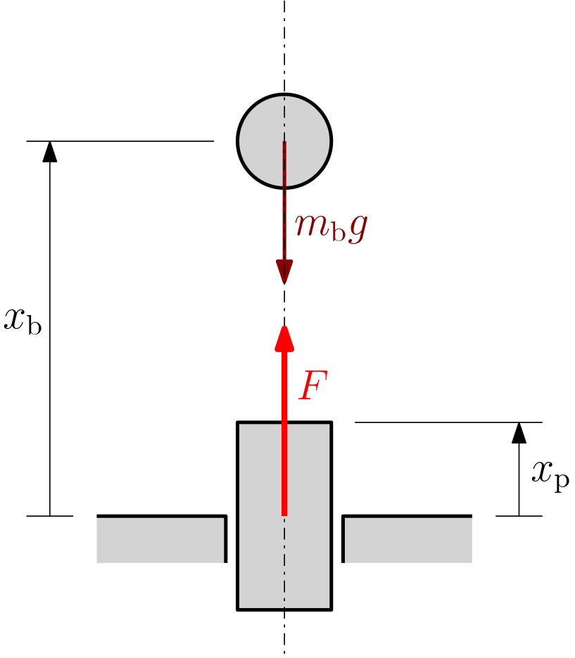
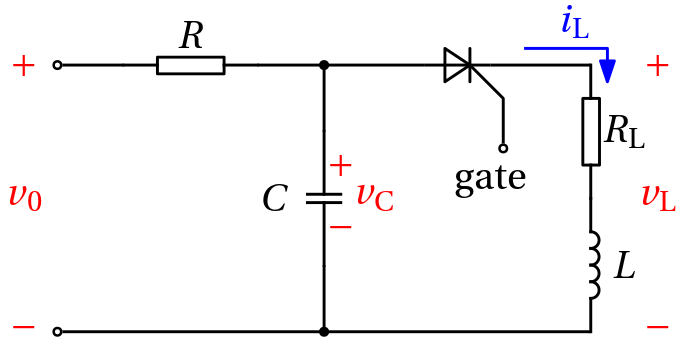
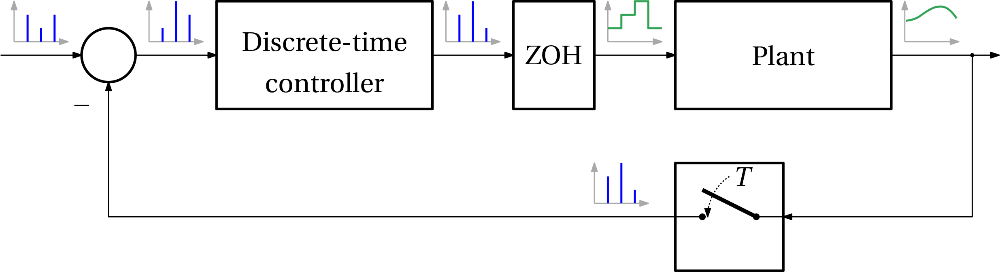
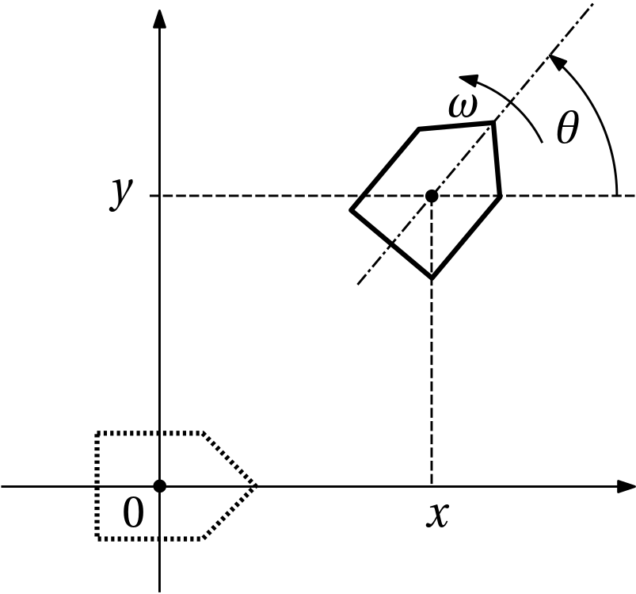
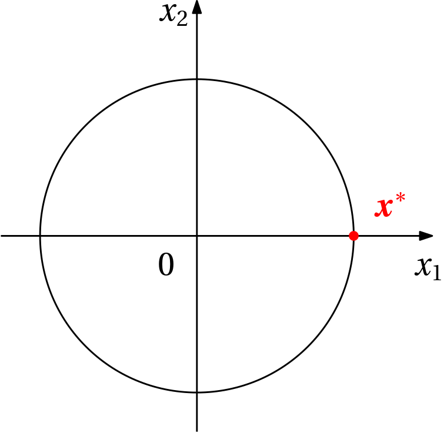
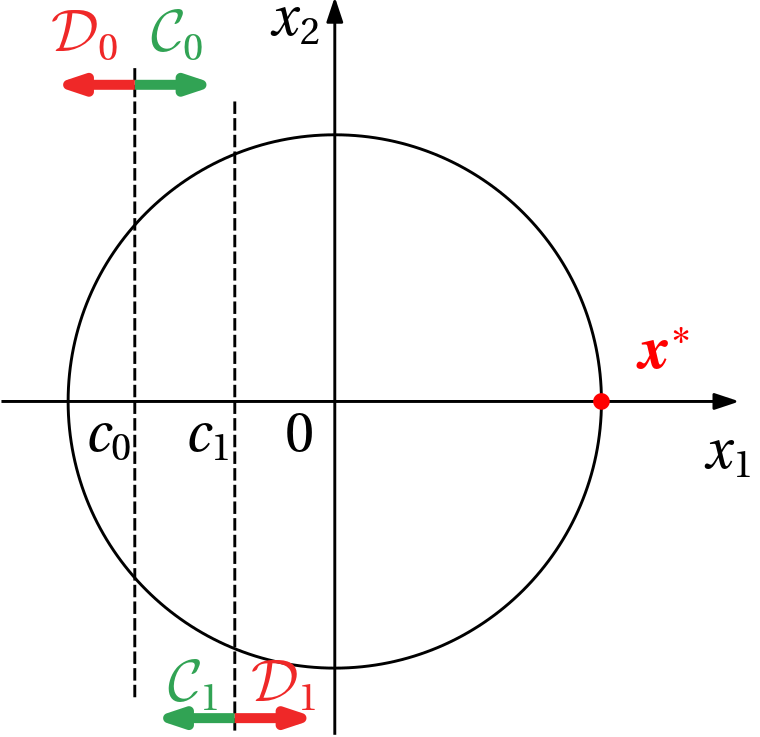
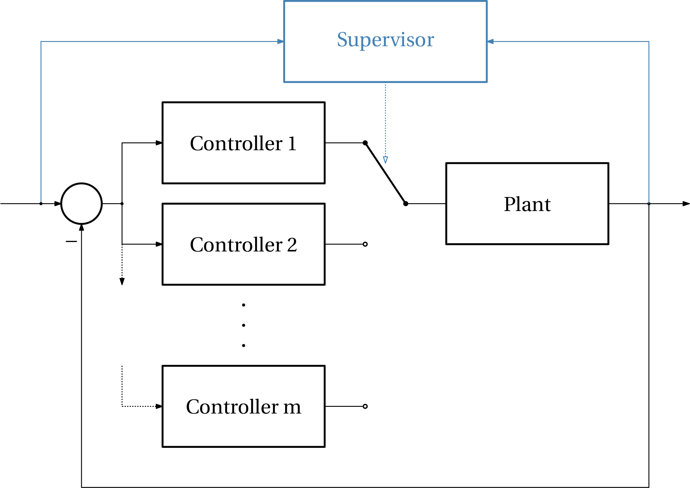
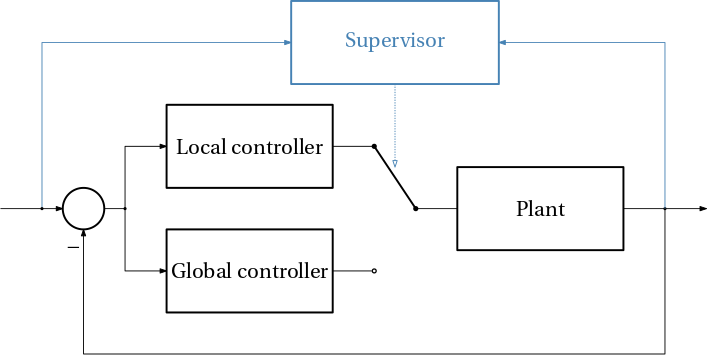
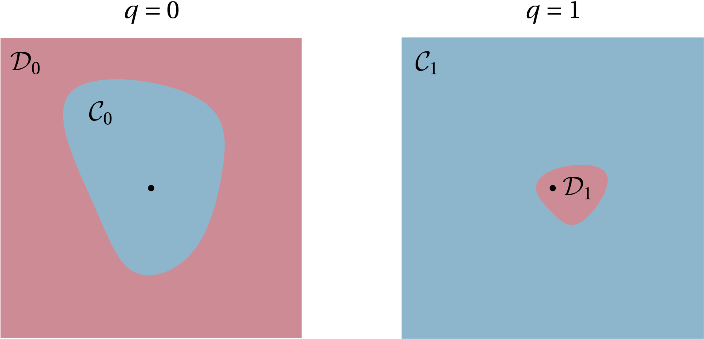

Here we introduce a major alternative framework to hybrid automata for modelling hybrid systems. It is called *hybrid equations*, sometimes also *hybrid state equations* to emphasize that what we are after is some kind of analogy with state equations $\dot{x}(t) = f(x(t), u(t))$ and $x_{k+1} = g(x_k, u_k)$ that we are familiar with from (continuous-valued) dynamical systems. Sometimes it is also called *event-flow equations* or *jump-flow* equations.

These are the key ideas:

- The (state) variables can change values discontinuously upon occurence of events – they *jump*.
- Between the jumps they evolve continuously – they *flow*.
- Some variables may only flow, they never jump.
- The variables staying constant between the jumps can be viewed as flowing too.

The major advantage of this modeling framework is that we do not have to distinguish between the two types of state variables. This is in contrast with hybrid automata, where we have to start by classifying the state variables as either continuous or discrete before moving on. In the current framework we treat all the variables identically – they mostly flow and occasionally (perhaps never, which is OK) jump.

## Hybrid equations 

It is high time to introduce hybrid (state) equations – here they come
$$
\begin{aligned}
\dot{x} &= f(x), \quad x \in \mathcal{C},\\
x^+ &= g(x), \quad x \in \mathcal{D},
\end{aligned}
$$
where 

- $f: \mathcal{C} \rightarrow \mathbb R^n$ is the *flow map*,
- $\mathcal{C}\subset \mathbb R^n$ is the *flow set*,
- $g: \mathcal{D} \rightarrow \mathbb R^n$ is the *jump map*, 
- $\mathcal{D}\subset \mathbb R^n$ is the *jump set*.

This model of a hybrid system is thus parameterized by the quadruple $\{f, \mathcal C, g, \mathcal D\}$.

## Hybrid inclusions

An extension of the presented framework of hybrid equations exists that may be useful in certain situations. Namely, the functions on the right-hand sides in both the differential and the difference equations no longer assign just a single value (as well-behaved functions do), but they assign sets!
$$
\begin{aligned}
\dot{x} &\in \mathcal F(x), \quad x \in \mathcal{C},\\
x^+ &\in \mathcal G(x), \quad x \in \mathcal{D}.
\end{aligned}
$$
where 

- $\mathcal{F}$ is the set-valued *flow map*,
- $\mathcal{C}$ is the *flow set*,
- $\mathcal{G}$ is the set-valued *jump map*, 
- $\mathcal{D}$ is the *jump set*.

One motivation for introduction of this set-valued framework is to model some uncertainty in the system. Later in this course we will also encounter another motivation for this extension: it turns out an appropriate and rigorous framework in some mathematically troublesome situations such as discontinuous right-hand sides of the differential equations.  

## Output equations

Typically a full model is only formed upon defining some output variables (oftentimes just a subset of possibly scaled state variables or their linear combinations). These output variables then obey some output equation
$$
y(t) = h(x(t)),
$$

or 
$$
y(t) = h(x(t),u(t)).
$$

::: {#exm-bouncing-ball}
## Bouncing ball
This is the "hello world example" for hybrid systems with state jumps (pun intended). The state variables are the height and the vertical speed of the ball.
$$
\bm x \in \mathbb{R}^2, \qquad \bm x = \begin{bmatrix}x_1 \\ x_2\end{bmatrix}.
$$

The quadruple defining the hybrid equations is
$$
\mathcal{C} = \{\bm x \in \mathbb{R}^2 \mid x_1>0 \lor (x_1 = 0, x_2\geq 0)\},
$$
$$
\mathbf f(\bm x) = \begin{bmatrix}x_2 \\ -g_0\end{bmatrix}, \qquad g_0 = 9.81,
$$
$$
\mathcal{D} = \{\bm x \in \mathbb{R}^2 \mid x_1 = 0, x_2 < 0\},
$$
$$
\mathbf g(\bm x) = \begin{bmatrix}x_1 \\ -\alpha x_2\end{bmatrix}, \qquad \alpha = 0.8.
$$

The two sets and two maps are illustrated below.

{width=55% #fig-bouncing-ball-maps-and-sets}
:::

::: {#exm-bouncing-ball-on-piston}
## Bouncing ball on a controlled piston

We now extend the simple bouncing ball example by adding a vertically moving piston. The piston is controlled by a force.

{width=40%}

In our analysis we neglect the sizes (for simplicity). The collision happens when $x_\mathrm{b} = x_\mathrm{p}$, and $v_\mathrm{b} < v_\mathrm{p}$.

The conservation of momentum after a collision reads
$$
m_\mathrm{b}v_\mathrm{b}^+ + m_\mathrm{p}v_\mathrm{p}^+ = m_\mathrm{b}v_\mathrm{b} + m_\mathrm{p}v_\mathrm{p}.
$${#eq-momentum-conservation}

The collision is modelled using a restitution coefficient
$$
v_\mathrm{p}^+ - v_\mathrm{b}^+ = -\gamma (v_\mathrm{p} - v_\mathrm{b}).
$${#eq-restitution}

From the momentum conservation @eq-momentum-conservation we get
$$
v_\mathrm{p}^+ = \frac{m_\mathrm{b}}{m_\mathrm{p}}v_\mathrm{b} + v_\mathrm{p} - \frac{m_\mathrm{b}}{m_\mathrm{p}}v_\mathrm{b}^+,
$$
which we substitute to @eq-restitution to get
$$
\frac{m_\mathrm{b}}{m_\mathrm{p}}v_\mathrm{b} + v_\mathrm{p} - \frac{m_\mathrm{b}}{m_\mathrm{p}}v_\mathrm{b}^+ - v_\mathrm{b}^+ = -\gamma (v_\mathrm{p} - v_\mathrm{b}),
$$
from which we express $v_\mathbb{b}^+$
$$
\begin{aligned}
v_\mathrm{b}^+ &= \frac{1}{1+\frac{m_\mathrm{b}}{m_\mathrm{p}}}\left(\frac{m_\mathrm{b}}{m_\mathrm{p}}v_\mathrm{b} + v_\mathrm{p} + \gamma (v_\mathrm{p} - v_\mathrm{b})\right)\\
&= \frac{m_\mathrm{p}}{m_\mathrm{p}+m_\mathrm{b}}\left(\frac{m_\mathrm{b}-\gamma m_\mathrm{p}}{m_\mathrm{p}}v_\mathrm{b} + (1+\gamma)v_\mathrm{p}\right)\\
&= \frac{m_\mathrm{b}-\gamma m_\mathrm{p}}{m_\mathrm{b}+m_\mathrm{p}}v_\mathrm{b} + \frac{(1+\gamma)m_\mathrm{p}}{m_\mathrm{p}+m_\mathrm{b}}v_\mathrm{p}
\end{aligned}.
$$

We substitute this into the expression for $v_\mathrm{p}^+$ to get
$$
\begin{aligned}
v_\mathrm{p}^+ &= \frac{m_\mathrm{b}}{m_\mathrm{p}}v_\mathrm{b} + v_\mathrm{p} - \frac{m_\mathrm{b}}{m_\mathrm{p}}\left(\frac{m_\mathrm{b}-\gamma m_\mathrm{p}}{m_\mathrm{b}+m_\mathrm{p}}v_\mathrm{b} + \frac{(1+\gamma)m_\mathrm{p}}{m_\mathrm{p}+m_\mathrm{b}}v_\mathrm{p}\right)\\
&= \frac{m_\mathrm{b}}{m_\mathrm{p}}\left(1-\frac{m_\mathrm{b}-\gamma m_\mathrm{p}}{m_\mathrm{b}+m_\mathrm{p}}\right) v_\mathrm{b} \\
&\qquad\qquad + \left(1-\frac{m_\mathrm{b}}{m_\mathrm{p}}\frac{(1+\gamma)m_\mathrm{p}}{m_\mathrm{p}+m_\mathrm{b}}\right) v_\mathrm{p}\\
&= \frac{m_\mathrm{b}}{m_\mathrm{b}+m_\mathrm{p}}(1+\gamma) v_\mathrm{b} + \frac{m_\mathrm{p}-\gamma m_\mathrm{b}}{m_\mathrm{p}+m_\mathrm{b}} v_\mathrm{p}.
\end{aligned}
$$

Finally we can simplify the expressions a bit by introducing $m=\frac{m_\mathrm{b}}{m_\mathrm{b}+m_\mathrm{p}}$. The jump equation is then
$$
\begin{bmatrix}
v_\mathrm{b}^+\\
v_\mathrm{p}^+
\end{bmatrix}
=
\begin{bmatrix}
m - \gamma (1-m) & (1+\gamma)(1-m)\\
m(1+\gamma) & 1-m-\gamma m
\end{bmatrix}
\begin{bmatrix}
v_\mathrm{b}\\
v_\mathrm{p}
\end{bmatrix}.
$$
:::

::: {#exm-synchronization-of-fireflies}
## Synchronization of fireflies

This is a famous example in synchronization. We consider $n$ fireflies, $x_i$ is the $i$-th firefly's clock, normalized to $[0,1]$. The clock resets (to zero) when it reaches 1. Each firefly can see the flashing of all other fireflies. As soon as it observes a flash, it increases its clock by $\varepsilon\times 100\, \%$.

Here is how we model the problem using the four-tuple $\{f, \mathcal C, g, \mathcal D\}$:
$$
\begin{aligned}
\mathcal{C} &= [0,1)^n = \{\bm x \in \mathbb R^n\mid x_i \in [0,1),\; i=1,\ldots,n \},\\
\bm f &= [f_1, f_2, \ldots, f_n]^\top,\quad f_i = 1, \quad i=1,\ldots,n,\\
\mathcal{D} &= \{\bm x \in [0,1]^n \mid \max_i x_i = 1 \},\\
\bm g &= [g_1, \ldots, g_n]^\top,\\ 
& \qquad g_i(x_i) = 
\begin{cases} 
(1 + \varepsilon)x_i, & \text{if } (1+\varepsilon)x_i < 1, \\ 
0, & \text{otherwise}.
\end{cases}
\end{aligned}
$$
:::


::: {#exm-thyristor-control}
## Thyristor control

Consider the circuit below.

{width=40% #fig-thyristor-control}

We consider a harmonic input voltage, that is, 
$$
\begin{aligned}
\dot v_0 &= \omega v_1\\
\dot v_1 &= -\omega v_0.
\end{aligned}
$$

The thyristor can be *on* (discrete state $q=1$) or *off* ($q=0$). The firing time $\tau$ is given by the firing angle $\alpha \in (0,\pi)$.

The state vector is
$$
\bm x = 
\begin{bmatrix}
v_0\\ v_1 \\ i_\mathrm{L} \\ v_\mathrm{C} \\ q \\ \tau
\end{bmatrix}.
$$

The flow map is
$$
\bm f(\bm x)
=
\begin{bmatrix}
\omega v_1\\
-\omega v_0\\
q \frac{v_\mathrm{C}-Ri_\mathrm{L}}{L}\\
-\frac{1}{CR}v_\mathrm{C} + \frac{1}{CR}v_\mathrm{0} - \frac{1}{C}i_\mathrm{L}\\
0\\
1
\end{bmatrix}.
$$

The flow set is
$$
\begin{aligned}
\mathcal{C} &= \{\bm x \mid q=0,\, \tau<\frac{\alpha}{\omega},\, i_\mathrm{L}=0\}\\ &\qquad \cup \{\bm x \mid q=1,\, i_\mathrm{L}>0\}.
\end{aligned}
$$

The jump set is
$$
\begin{aligned}
\mathcal{D} &= \{\bm x \mid q=0,\, \tau\geq \frac{\alpha}{\omega},\, i_\mathrm{L}=0,\, v_\mathrm{C}>0\}\\ &\qquad \cup \{\bm x \mid q=1,\, i_\mathrm{L}=0,\, v_\mathrm{C}<0\}.
\end{aligned}
$$

The jump map is
$$
\bm g(\bm x) = 
\begin{bmatrix}
u_0\\ u_1 \\ i_\mathrm{L} \\ v_\mathrm{C} \\ {\color{red} 1-q} \\ {\color{red} 0}
\end{bmatrix}.
$$

The last condition in the jump set comes from the requirement that not only must the current through the inductor be zero, but also it must be decreasing. And from the state equation it follows that the voltage on the capacitor must be negative.
:::

::: {#exm-sampled-data-feedback}
## Sampled-data feedback control

Another example of a dynamical system that fits nicely into the hybrid equations framework is sampled-data feedback control system. Within the feedback loop in @fig-sampled-data-feedback, we recognize a continuous-time plant and a discrete-time controller.

{width=70% #fig-sampled-data-feedback}

The plant is modelled by $\dot{\bm x}_\mathrm{p} = \mathbf f_\mathrm{p}(\bm x_\mathrm{p},\bm u), \; \bm y = \mathbf h(\bm x_\mathrm{p})$. The controller samples the output $T$-periodically and computes its own output as a nonlinear function $\bm u = \bm\kappa(\mathbf r-\bm y)$.

The closed-loop model is then 
$$
\dot{\bm x}_\mathrm{p} = \mathbf f_\mathrm{p}(\bm x_\mathrm{p},\bm \kappa(\mathbf r-\bm h(\bm x_\mathrm{p}))), \; y = h(\bm x_\mathrm{p}).
$$

The closed-loop (hybrid) state vector is
$$
\bm x = 
\begin{bmatrix}
\bm x_\mathrm{p}\\ \bm u \\ \tau
\end{bmatrix}
\in
\mathbb R^n \times \mathbb R^m \times \mathbb R.
$$

The flow set is
$$
\begin{aligned}
\mathcal{C} &= \{\bm x \mid \tau \in [0,T)\},
\end{aligned}
$$
or perhaps better (see @sec-closedness-of-the-sets on preference for closedness of the sets)
$$
\begin{aligned}
\mathcal{C} &= \{\bm x \mid \tau \in [0,T]\}.
\end{aligned}
$$

The flow map is
$$
\mathbf f(\bm x)
=
\begin{bmatrix}
\mathbf f_\mathrm{p}(\bm x_\mathrm{p},u)\\
\bm 0\\
1
\end{bmatrix}.
$$

The jump set is
$$
\begin{aligned}
\mathcal{D} &= \{\bm x \mid \tau = T\}.
\end{aligned}
$$
or rather (in anticipation of numerical implementation)
$$
\begin{aligned}
\mathcal{D} &= \{\bm x \mid \tau \geq T\}.
\end{aligned}
$$

The jump map is
$$
\mathbf g(\bm x) = 
\begin{bmatrix}
\bm x_\mathrm{p}\\
\bm \kappa(\mathbf r-\bm y)\\
0
\end{bmatrix}.
$$

:::{.callout-tip}
### Why bother with modelling this as a hybrid system when we have modeling tools such as Simulink for this blend of continuous-time and discrete-time systems?
You may wonder why we bother with modelling this system as a hybrid system at all. When it comes to analysis of the closed-loop system, implementation of the model in Simulink allows for seemless mixing of continuous-time and dicrete-time blocks. And when it comes to control design, we can either discretize the plant and design a discrete-time controller, or design a continuous-time controller and then discretize it. There seems to be no need for new framing and theories. Well, in both cases the model is ultimately discrete-time and the model no longer represents the behaviour of the system between the sampling instants. Analyzing such systems, even using numerical simulation, gives us no warning about the intersample behaviour. The need for such capability is even more pronounced when the sampling period $T$ is not be constant – it can either vary randomly or perhaps the sampling can be event-triggered. All these scenarios are systematically handled within the hybrid equations framework. 
:::

We now demonstrate the usage of hybrid equations for sampled-date control on a simple numerical example. A continuous-time model of the plant (double mass-spring-damper) is given first, then an LQR controller is designed for a ZOH-discretized model. A feedforward term is added to the controll law. 
```{julia}
#| code-fold: true
using ControlSystems
using LinearAlgebra

#---------------------------------------------------------------------------------------------------------
# Discrete-time design of the controller
#---------------------------------------------------------------------------------------------------------

# System parameters
m₁ = 1      # Mass 1
m₂ = 0.1    # Mass 2
b₁₂ = 0.03  # Damping coefficient between the two masses
k₁₂ = 0.09  # Spring stiffness between the two masses
b₀₁ = 0.3   # Damping coefficient between the first mass and the wall
k₀₁ = 0.5   # Spring stiffness between the first mass and the wall

# Plant state vector: xₚ = [y'; y; d'; d],
# where y is the position of the first mass, and d is the position of the second mass.

# State matrices of the continuous-time plant
Ac = [-(b₁₂+b₀₁)/m₁ -(k₁₂+k₀₁)/m₁ b₁₂/m₁ k₁₂/m₁;
    1 0 0 0;
    b₁₂/m₂ k₁₂/m₂ -b₁₂/m₂ -k₁₂/m₂;
    0 0 1 0]
Bc = [1/m₁; 0; 0; 0]        # The force (the control input) acts on the first mass.
Cc = [0 0 0 1]              # We want to control the position of the second mass, d.
Dc = [0]

# ZOH discretization
G = ss(Ac, Bc, Cc, Dc)
T = 1.0                     # Sampling time
Gd = c2d(G, T)
A, B, C, D = ssdata(Gd)

# Feedforward for reference tracking
N = [A-I B; C 0]\[0; 0; 0; 0; 1]
Nₓ = N[1:4]
Nᵤ = N[5]

# LQR design
Q = C'*10.0*C
R = 1.0
K = lqr(Discrete, A, B, Q, R)

# Control law
y_ref(t) = 1.0(t>=2.0)      # Reference output (step function starting at t=2)
N = K*Nₓ .+ Nᵤ
κ(xₚ,r) = -K*xₚ .+ N*r      # Control law (u is a function of the plant state xₚ and the reference r)
```

Now that we have the continuous-time plant $\dot{\bm x} = \mathbf{A}\bm{x} + \mathbf{B}u$ and the discrete-time control law $u = \kappa(\bm{x}_\mathrm{p}, \mathrm{r})$, we can model the closed-loop system using hybrid equations, that is, we define the quadruple $\{\mathbf f, \mathcal C, \mathbf g, \mathcal D\}$. In fact, the latter two we model as functions that return `true` if the state is in the corresponding set.

```{julia}
#| code-fold: show
#| output: false
n = 4                       # Dimension of the plant state xₚ

# Flow set and jump set
function isinC(x)
    τ = x[n+2]
    return τ <= T           # Flow is possible as long as the timer has not exceeded the sampling time.
end

function isinD(x)
    τ = x[n+2]
    return τ >= T           # Jump is possible once the timer has reached the sampling time.
end

# Flow map: the plant evolves, the ZOH output stays constant, the timer runs.
function f(x)
    xₚ, u = x[1:n], x[n+1]
    return [Ac*xₚ + Bc*u;   # ẋₚ = Ac xₚ + Bc u
            0.0;            # u̇ = 0
            1.0]            # τ̇ = 1
end

# Jump map: the plant state does not change, a new control is computed and stored (to be held), the timer is reset.
# The reference r enters as an exogenous input (otherwise, time would have to be included in the state too).
function g(x,r)
    xₚ = x[1:n]
    return [xₚ;             # xₚ⁺ = xₚ
            κ(xₚ,r);        # u⁺ = κ(xₚ,r)
            0.0]            # τ⁺ = 0
end
```

Now comes the simulation. We rely on the popular [OrdinaryDiffEq.jl](https://docs.sciml.ai/OrdinaryDiffEq/stable/) package. We must define a `DiscreteCallback` that checks whether the state is in the jump set and if so, applies the jump map. The key thing is that the condition is checked **at the end of each integration step** (see the section [Event Handling and Callback Functions](https://docs.sciml.ai/DiffEqDocs/stable/features/callback_functions/) in the documentation). More on the implications after we see the results.
```{julia}
#| code-fold: show
#| output: false
using OrdinaryDiffEq

f!(dx,x,p,t) = (dx .= f(x))     # The flow map in the format required by the ODE solver.

# The condition is only checked at the end of each integration step (DiscreteCallback).
# Jumps have priority over flows when x is in both C and D.
# If x is in neither C nor D, the solution cannot be continued and the simulation is terminated.
condition(x,t,integrator) = isinD(x) || !isinC(x)

function affect!(integrator)
    x = integrator.u            # Note that within the DifferentialEquations.jl ecosystem, u denotes the state.
    t = integrator.t
    if isinD(x)
        integrator.u .= g(x,y_ref(t))
    else
        terminate!(integrator)
    end
end

jump_cb = DiscreteCallback(condition,affect!)

# Setting up the simulation problem
xₚ_init = [0, 0.0, 0, 0.0]
u_init = 0.0
τ_init = 0.0
x_init = [xₚ_init; u_init; τ_init]
tspan = (0.0,10.0)
prob = ODEProblem(f!,x_init,tspan)

# Solving the simulation problem
sol = solve(prob,Tsit5(),callback=jump_cb,dtmax=0.1)
```

Finally, we plot the results in @fig-sampled-data-feedback-control-results
```{julia}
#| code-fold: true
#| fig-cap: Simulation results of the sampled-data feedback control
#| label: fig-sampled-data-feedback-control-results
using Plots
t = tspan[1]:T:tspan[2]
p1 = plot(sol, idxs=4, ylabel="Tracked output", lab="d", lw=2, color=palette(:default)[4])
plot!(t, y_ref.(t), lab="reference", lw=2, ls=:dash, seriestype=:steppost)
p2 = plot(sol, idxs=1:n, ylabel="Plant state", lab=["y dot" "y" "d dot" "d"], lw=2, legend_position=:topright)
p3 = plot(sol, idxs=n+1, ylabel="Control", lab="u", lw=2)
p4 = plot(sol, idxs=n+2, ylabel="Timer", lab="τ", lw=2, xlabel="t")
plot(p1, p2, p3, p4, layout=(4,1), size=(400,600))
```

We can observe that the plant output $d$ tracks the reference signal well, and the control input $u$ is updated at each sampling instant. So far, so good! But we can also observe that the times at which the jumps occur are not exactly at the sampling instants – the sampling period is 1. How come? This behaviour is a consequence of our choice of the `DiscreteCallback` in the simulation. The condition for a jump is only checked at the end of each integration step, and as the integration step size varies adaptively, the integration ticks determined in this way are not necessarily aligned with the desired periodic sampling instants. 

There are several ways to improve this. First, we can use the `PeriodicCallback` of [DiffEqCallbacks.jl](https://docs.sciml.ai/DiffEqCallbacks/) package, which ensures that jumps occur exactly at the specified (periodic) sampling instants. Although it would fit our current problem perfectly, we want to present a more general solution in which the sampling times are not prescribed but are derived from the actual state trajectories of the system. For this, the appropriate choice is the `ContinuousCallback` of the same standard OrdinaryDiffEq.jl package.

We do it here. Instead of the logical functions `isinC` and `isinD`, a real-valued function is needed. Its zero crossing (from negative to positive) marks the instant when the state reaches the jump set $\mathcal D = \{\bm x \in \mathbb R^{n+2} \mid \tau \geq T\}$. The solver then locates this instant by numerical root finding.
```{julia}
#| code-fold: show
#| output: false
function jump_set_crossing_fcn(x)
    τ = x[n+2]
    return τ - T
end

condition_zc(x,t,integrator) = jump_set_crossing_fcn(x)

function affect_zc!(integrator)
    x = integrator.u
    t = integrator.t
    integrator.u .= g(x,y_ref(t))
end

jump_zc_cb = ContinuousCallback(condition_zc,affect_zc!,nothing)  # Only upcrossings (from C into D) trigger a jump.

# Solving the simulation problem (no need to limit the step size now)
sol_zc = solve(prob,Tsit5(),callback=jump_zc_cb)
```

We now plot the solution in @fig-sampled-data-feedback-control-results-zc.
```{julia}
#| code-fold: true
#| fig-cap: Simulation results of the sampled-data feedback control with zero-crossing detection
#| label: fig-sampled-data-feedback-control-results-zc
p5 = plot(sol_zc, idxs=4, ylabel="Tracked output", lab="d", lw=2, color=palette(:default)[4])
plot!(t, y_ref.(t), lab="reference", lw=2, ls=:dash, seriestype=:steppost)
p6 = plot(sol_zc, idxs=1:n, ylabel="Plant state", lab=["y dot" "y" "d dot" "d"], lw=2, legend_position=:topright)
p7 = plot(sol_zc, idxs=n+1, ylabel="Control", lab="u", lw=2)
p8 = plot(sol_zc, idxs=n+2, ylabel="Timer", lab="τ", lw=2, xlabel="t")
plot(p5, p6, p7, p8, layout=(4,1), size=(400,600))
```

We can see that the jumps now occur exactly at the sampling instants (multiples of $T=1$).
:::

:::{.callout-tip}
### Event detection and handling in Matlab
Although in the examples we use Julia, we do not intend to lock you into one particular programming language and its ecosystem. Similar functionality for event detection and handling is also available in Matlab, see [ODE Event Location](https://www.mathworks.com/help/matlab/math/ode-event-location.html).
:::

## Closedness of the sets {#sec-closedness-of-the-sets}

While it is perfectly legitimate during modelling to choose if the flow and jump sets are defined as open or closed sets, an assumption is often made in the theories proposed for hybrid systems that these are closed. We are not going to delve into details in our course though, they can be found in the literature.

## Hybridness after closing the loop

We have defined *hybrid systems*, but what exactly is hybrid when we close a feedback loop? There are three possibilities:

- Hybrid plant + continuous controller.
- Hybrid plant + hybrid controller.
- Continuous plant + hybrid controller.

The first case is encountered when we use a standard controller such as a PID controller to control a system whose dynamics can be characterized/modelled as hybrid. The second scenario considers a controller that mimicks the behavior of a hybrid system. The third case is perhaps the least intuitive: although the plant to be controller is continuous(-valued), it may still make sense to design and implement a hybrid controller, see the next paragraph. 

## Impossibility to stabilize without a hybrid controller

::: {#exm-unicycle-stabilization}
## Unicycle stabilization
We consider a unicycle model of a vehicle in a plane, characterized by the position and orientation, with the controlled forward speed $v$ and the yaw (turning) angular rate $\omega$.

{width=30% #fig-unicycle-stabilization}

The vehicle is modelled by
$$
\begin{aligned}
\dot x &= v \cos \theta,\\
\dot y &= v \sin \theta,\\
\dot \theta &= \omega,
\end{aligned}
$$

$$
\bm x = \begin{bmatrix}
x\\ y\\ \theta
\end{bmatrix},
\quad 
\bm u = \begin{bmatrix}
v\\ \omega
\end{bmatrix}.
$$

It is known that this system cannot be stabilized by a continuous feedback controller. The general result that applies here was published in @brockettAsymptoticStabilityFeedback1983. The condition of stabilizability by a time-invariant continuous state feedback is that the image of every neighborhood of the origin under $(\bm x,\bm u) \mapsto \bm f(\bm x, \bm u)$ contains some neighborhood of the origin. This is not the case here. The map from the state-control space to the velocity space is

$$
\begin{bmatrix}
x\\ y\\ \theta\\ v\\ \omega 
\end{bmatrix}
\mapsto
\begin{bmatrix}
v \cos \theta\\
v \sin \theta \\
\omega
\end{bmatrix}.
$$

Now consider a neighborhood of the origin such that $|\theta|<\frac{\pi}{2}$. It is impossible to get $\bm f(\bm x, \bm u) = \begin{bmatrix}
0\\ f_2 \\ 0\end{bmatrix}, \; f_2\neq 0$. Hence, stabilization by a continuous feedback $\bm u = \kappa (\bm x)$ is impossible. 

But it is possible to stabilize the vehicle using a discontinuous feedback. And discontinuous feedback controller can be viewed as switching control, which in turn can be seen as instance of a hybrid controller.
:::

::: {#exm-stabilization-on-a-circle}
## Global asymptotic stabilization on a circle

We now give a demonstration of a general phenomenon of stabilization on a manifold. We will see that even if asymptotic stabilization by a continuous feedback is possible, it may not be possible to guarantee it globally.

::: {.callout-tip}
## Why control on manifolds?
First, recall that a manifold is a solution set for a system of nonlinear equations. A prominent example is a unit circle $\mathbb S_1 = \{\bm x \in \mathbb R^2 \mid x_1^2 + x_2^2 - 1 = 0\}$. An extension to two variables is then $\mathbb S_2 = \{\bm x \in \mathbb R^4  \mid x_1^2 + x_2^2 - 1 = 0, \, x_3^2 + x_4^2 - 1 = 0\}$. Now, why shall we bother to study control within this type of a state space? It turns out that such models of state space are most appropriate in mechatronic/robotic systems wherein angular variables range more than $360^\circ$. We worked on this kind of a system some time ago when designing a control system for [inertially stabilized gimballed camera platforms](https://wiki.control.fel.cvut.cz/archiv/aa4cc/content/inertial-stabilization-and-visual-servoing-aerial-surveilance.html).


:::

In this example we restrict the motion of of a particle to sliding around a unit circle $\mathbb S_1$ is modelled by  
$$
\dot{\bm x} = u\begin{bmatrix}0 & -1\\ 1 & 0\end{bmatrix}\bm x,
$$
where $\bm x \in \mathbb S^1,\quad u\in \mathbb R$.

The point to be stabilized is $\bm x^* = \begin{bmatrix}1\\ 0\end{bmatrix}$.

{width=30% #fig-stabilization-on-a-circle}

What is required from a globally asymptotically stabilizing controller? 

- Solutions stay in $\mathbb S^1$,
- Solutions converge to $\bm x^*$,
- If a solution starts near $\bm x^*$, it stays near.

One candidate is 
$$\kappa(\bm x) = -x_2.$$

Define the (Lyapunov) function 
$$V(\bm x) = 1-x_1.$$

Indeed, it does qualify as a Lyapunov function because it is zero at $\bm x^*$ and positive elsewhere. Furthermore, its time derivative along the solution trajectory is
$$
\begin{aligned}
\dot V &= \left(\nabla_{\bm{x}}V\right)^\top \dot{\bm x}\\
&= \begin{bmatrix}-1 & 0\end{bmatrix}\left(-x_2\begin{bmatrix}0 & -1\\ 1 & 0\end{bmatrix}\begin{bmatrix} x_1 \\ x_2 \end{bmatrix}\right)\\
&= -x_2^2\\
&= -(1-x_1^2),
\end{aligned}
$$
from which it follows that 
$$
\dot V < 0 \quad \forall \bm x \in \mathbb S^1 \setminus \{-1,1\}.
$$

With $u=-x_2$ the point $\bm x^*$ is stable but not globally atractive, hence it is not globally asymptotically stable.

Can we do better? 

Yes, we can. But we need to incorporate some switching into the controller. Loosely speaking anywhere except for the state (-1,0), we can apply the previously designed controller, and at the troublesome state (-1,0), or actually in some region around it, we need to switch to another controller that would drive the system away from the problematic region. 

But we will take this example as an opportunity to go one step further and instead of just a switching controller we design a hybrid controller. The difference is that within a hybrid controller we can incorporate some hysteresis, which is a robustifying feature. In order to do that, we need to introduce a new state variable $q\in\{0,1\}$. Determination of the flow and jump sets is sketched in @fig-stabilization-on-a-circle-hybrid.

{width=30% #fig-stabilization-on-a-circle-hybrid}

Note that there is no hysteresis if $c_0=c_1$, in which case the hybrid controller reduces to a switching controller (but more on switching controllers in the next chapter).

The two feedback controllers are given by
$$
\begin{aligned}
\kappa(\bm x,0) &= \kappa_0(\bm x) = -x_2,\\
\kappa(\bm x,1) &= \kappa_1(\bm x) = -x_1.
\end{aligned}
$$

The flow map is (DIY)
$$
f(\bm x, q) = \ldots
$$

The flow set is
$$
\mathcal{C} = (\mathcal C_0 \times \{0\}) \cup (\mathcal C_1 \times \{1\}).
$$

The jump set is
$$
\mathcal{D} = (\mathcal D_0 \times \{0\}) \cup (\mathcal D_1 \times \{1\}).
$$

The jump map is
$$
g(\bm x, q) = 1-q \quad \forall [\bm x, q]^\top \in \mathcal D.
$$

Simulation using Julia is provided below.

```{julia}
#| label: fig-simulation-stabilization-on-a-circle
#| fig-cap: "Simulation of stabilization on a circle using a hybrid controller"

using OrdinaryDiffEq

# Defining the sets and functions for the hybrid equations

c₀, c₁ = -2/3, -1/3

is_in_C(x,q) = (x[1] >= c₀ && q == 0) || (x[1] <= c₁ && q == 1) # Actually not really needed, just a complement of D.
is_in_D(x,q) = (x[1] < c₀ && q == 0) || (x[1] > c₁ && q == 1) 

g(x,q) = 1-q

κ(x,q) = q==0 ? -x[2] : -x[1] 

function f!(dx,x,q,t)               # Already in the format for the ODE solver.
    A = [0.0 -1.0; 1.0 0.0] 
    dx .= A*x*κ(x,q)
end

# Defining the initial conditions for the simulation

cᵢ = (c₀+c₁)/2
x₀ = [cᵢ,sqrt(1-cᵢ^2)]
q₀ = 1

# Setting up the simulation problem

tspan = (0.0,10.0)
prob = ODEProblem(f!,x₀,tspan,q₀)

function condition(x,t,integrator)
    q = integrator.p 
    return is_in_D(x,q)
end

function affect!(integrator)
    q = integrator.p
    x = integrator.u 
    integrator.p = g(x,q)
end

cb = DiscreteCallback(condition,affect!)

# Solving the simulation problem

sol = solve(prob,Tsit5(),callback=cb,dtmax=0.1) # ContinuousCallback more suitable here

# Plotting the results of the simulation

using Plots
gr(tickfontsize=6,legend_font_pointsize=6,guidefontsize=6)

plot(sol,label=["x₁" "x₂"],xaxis="t",yaxis="x",lw=2,size=(400,200))
hline!([c₀], label="c₀")
hline!([c₁], label="c₁")
```

The solution can also be visualized in the state space.

```{julia}
#| label: fig-simulation-stabilization-on-a-circle-XY
#| fig-cap: "Simulation of stabilization on a circle using a hybrid controller"

plot(sol,idxs=(1,2),label="",xaxis="x₁",yaxis="x₂",lw=2,aspect_ratio=1,size=(400,400))
vline!([c₀], label="c₀")
vline!([c₁], label="c₁")
scatter!([x₀[1]],[x₀[2]],label="x init")
scatter!([1],[0],label="x ref")
```
:::

:::{.callout-warning}
### On implementation of hybrid equations using general-purpose solvers for ordinary differential equations
While the fact that we do not have to distinguish between continuous- and discrete-valued makes hybrid (state) equations convenient for theoretical analysis, when it comes to numerical simulation, it is a waste of computational resources to include among other general ODEs also the equations $\dot x_i = 0$, and solve them numerically. This we also reflected in the simulation code above by explicitly keeping the discrete state variable constant between the jumps.

The only sofware for hybrid equations that we are aware of is [HyEQ toolbox for Matlab](https://www.mathworks.com/matlabcentral/fileexchange/41372-hybrid-equations-toolbox). While it is a convenient educational tool, it is not an optimized numerical solver. 
:::


## Supervisory control

Yet another problem that can benefit from being formulated as a hybrid system is *supervisory control*. 

{width=60% #fig-supervisory-control}


## Combining local and global controllers $\subset$ supervisory control

As a subset of supervisory control we can view a controller that switches between a global and a local controller.

{width=60% #fig-local-global-controllers}

Local controllers have good transient response but only work well in a small region around the equilibrium state.
Global controllers have poor transient response but work well in a larger region around the equilibrium state.

A useful example is that of swinging up and stabilization of a pendulum: the local controller can be designer for a linear model obtained by linearization about the upright orientation of the pendulum. But such controller can only be expected to perform well in some small region around the upright orientation. The global controller is designed to bring the pendulum into that small region.

The flow and jump sets for the local and global controllers are in @fig-local-global-sets. Can you tell, which is which? Remember that by introducing the discrete variable $q$, some hysteresis is in the game here.

{width=60% #fig-local-global-sets}