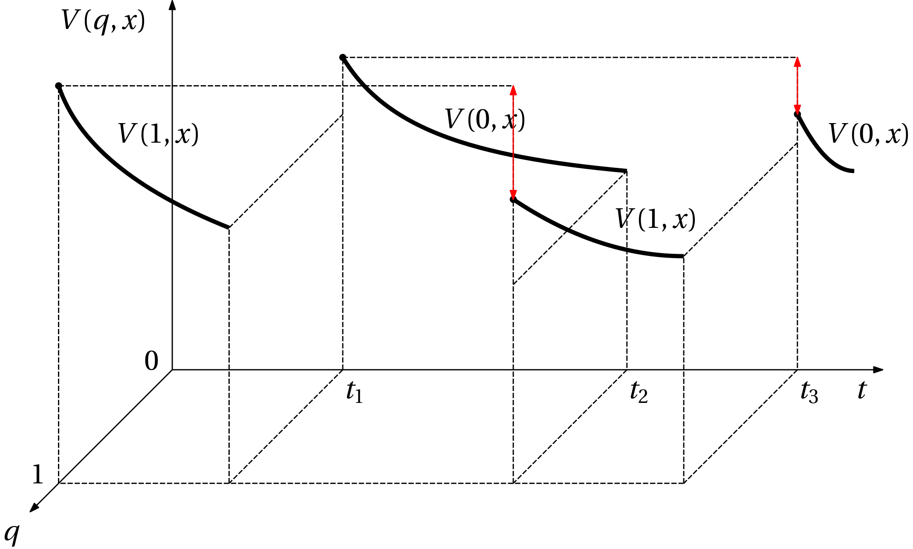
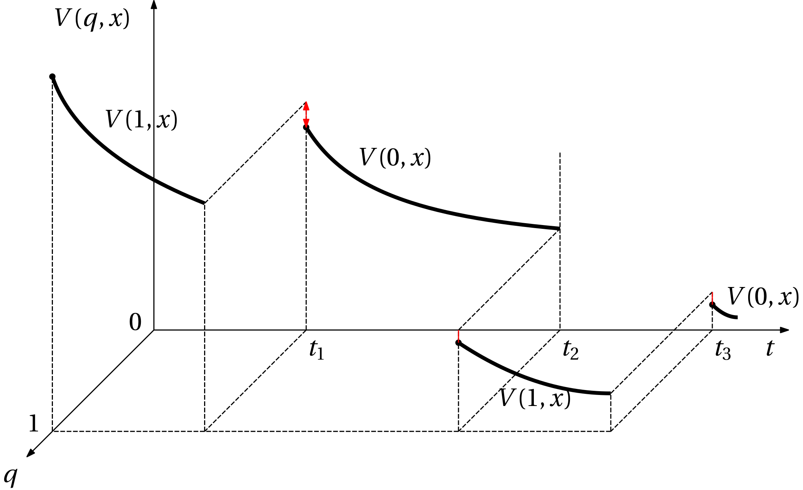

Having just recalled the stability analysis based on searching for a Lyapunov function, we now extend the analysis to hybrid systems, in particular, hybrid automata. 

## Hybrid system stability analysis via Lyapunov function

In contrast to continuous systems where Lyapunov functin should decrease along the state trajectory to certify asymptotic stability (or at least should not increase to certify Lyapunov stability), in hybrid systems the requirement can be relaxed a bit. 

A Lyapunov function should still decrease along the continuous state trajectory while the system resides in a given discrete state (mode), but during the transition between the modes the function can be discontinuous, and can even increase. But then upon return to the same discrete state, the function should have lower value than it had last time it entered the state to certify asymptotic stability (or at least not larger for Lyapunov stability), see @fig-lyapunov-like-function. 

{#fig-lyapunov-like-function}

Formally, the function $V(q,\bm x)$ has two variables $q$ and $\bm x$, it is smooth in $\bm x$, and  
$$
V(q,\bm 0) = 0, \quad V(q,\bm x) > 0 \; \text{for all nonzero} \; \bm x \; \text{and for all nonzero} \; q,
$$

$$
\left(\nabla_x V(q,\bm x)\right)^\top \mathbf f(q,\bm x) < 0  \; \text{for all nonzero} \; \bm x \; \text{and for all nonzero} \; q,
$$

and the discontinuities at transitions must satisfy the conditions sketched in @fig-lyapunov-like-function. If Lyapunov stability is enough, the strict inequality can be relaxed to nonstrict.

### Stricter condition on Lyapunov function

Verifying the properties just described is not easy. Perhaps the only way is to simulate the system, evaluate the function along the trajectory and check if the conditions are satisfied, which is hardly useful. A stricter condition is in @fig-stricter-lyapunov-like-function. Here we require that during transitions to another mode, the fuction should not increase. Discontinuous reductions in value are allowed, but enforcing continuity introduced yet another simplification that can be plausible for analysis.

{#fig-stricter-lyapunov-like-function}

## Further restricted set of candidate functions: common Lyapunov function (CLF)

In the above, we have considered a Lyapunov function $V(q,\bm x)$ that is mode-dependent. But what if we could find a single Lyapunov function $V(\bm x)$ that is common for all modes $q$? This would be a great simplification.

This, however, implies that at a given state $\bm x$, arbitrary transition to another mode $q$ is possible. We add and adjective *uniform* the stabilty (either Lyapunov or asymptotic) to emphasize that the function is common for all modes.

In terminology of switched systems, we say that arbitrary switching is allowed. And staying in the domain of switched systems, the analysis can be interpreted within the framework of differential inclusions
$$
\dot{\bm x} \in \{f_1(\bm x), f_2(\bm x),\ldots,f_m(\bm x)\}.
$$

## (Global) uniform asymptotic stability

Having agreed that we are now searching for a single function $V(\bm x)$, the function must satisfy 
$$\boxed{\kappa_1(\|\bm x\|) \leq V(\bm x) \leq \kappa_2(\|\bm x\|),}$$
where $\kappa_1(\cdot), \kappa_2(\cdot)$ are class $\mathcal{K}$ comparison functions, and $\kappa_1(\cdot)\in\mathcal{K}_\infty$ if global asymptotic stability is needed, and
$$
\boxed{\left(\nabla V(\bm x)\right)^\top \mathbf f_q(\bm x) \leq -\rho(\|\bm x\|),\quad q\in\mathcal{Q},}
$$
where $\rho(\cdot)$ is a positive definite continuous function, zero at the origin. If all these are satisfied, the system is (globally) uniformly asymptotically stable (GUAS).

Similarly as we did in continuous systems, we must ask if stability implies existence of a common Lyapunov function. An affirmative answer comes in the form of a *converse theorem* for global uniform asymptotic stability (GUAS).

This is great, a CLF exists for a GUAS system, but how do we find it? We must restrict the set of candidate functions and then search within the set. Obviously, if we fail to find a function in the set, we must extend the set and search again... 
    
## Common quadratic Lyapunov function (CQLF)

An immediate restriction of a set of Lyapunov functions is to positive definite quadratic functions
$$\boxed{
V(\bm x) = \bm x^\top \bm P \bm x,}
$${#eq-quadratic-lyapunov-function}
where $\bm P=\bm P^\top \succ 0$.

This restriction is also quite natural because for linear systems, it is known that we do not have to consider anything more complicated than quadratic functions. This does not hold in general for nonlinear and hybrid systems. But it is a good start. If we succeed in finding a quadratic Lyapunov function, we can be sure that the system is stable. 

Here we start by considering a hybrid automaton for which at each mode the dynamics is linear. We consider $r$ continuous-time LTI systems parameterized by the system matrices $\mathbf A_i$ for $i=1,\ldots, r$ as 
$$
\dot{\bm x} = \mathbf A_i \bm x(t).
$$

Time derivatives of $V(\bm x)$ along the trajectory of the $i$-th system
$$
  \nabla V(\bm x)^\top \left.\frac{\mathrm d \bm x}{\mathrm d t}\right|_{\dot{\bm x} = \mathbf A_i \bm x} = \bm x^\top(\mathbf A_i^\top \bm P + \bm P\mathbf A_i)\bm x,
$$  

which, upon introduction of new matrix variables $\bm Q_i=\bm Q_i^\top$ given by   
$$
  \mathbf A_i^\top \bm P + \bm P\mathbf A_i = \bm Q_i,\qquad i=1,\ldots, r
$$
yields  
$$
  \dot V(\bm x) = \bm x^\top \bm Q_i\bm x,
$$
from which it follows that $\bm Q_i$ (for all $i=1,\ldots,r$) must satisfy  
$$
  \bm x^\top \bm Q_i \bm x \leq 0,\qquad i=1,\ldots, r
$$  
for (Lyapunov) stability and   
$$
  \bm x^\top \bm Q_i \bm x < 0,\qquad i=1,\ldots, r
$$  
for asymptotic stability.

As a matter of fact, we could have proceeded without introducing new variables $\bm Q_i$ and just write the conditions directly in terms of $\mathbf A_i$ and $\bm P$ for (Lyapunov) stability
$$\boxed{
  \bm x^\top (\mathbf A_i^\top \bm P + \bm P\mathbf A_i) \bm x \leq 0,\qquad i=1,\ldots, r,}
$${#eq-clf-for-lyapunov-stability-as-function}  
and for asymptotic stability  
$$\boxed{
  \bm x^\top (\mathbf A_i^\top \bm P + \bm P\mathbf A_i) \bm x < 0,\qquad i=1,\ldots, r.}
$${#eq-clf-for-asymptotic-stability-as-function}  

## Linear matrix inequality (LMI)

The conditions of quadratic stability that we have just derived are conditions on functions. However, in this case of a quadratic Lyapunov function and linear systems, the condition can also be written directly in terms of matrices. For that we use the concept of a *linear matrix inequality* (LMI).

Recall that a linear inequality is an inequality of the form $\underbrace{a_0 + a_1x_1 + a_2x_2 + \ldots + a_rx_r}_{a(\bm x)} > 0$. 

:::{.callout-note}
## Linear vs. affine
We could perhaps argue that as the function $a(x)$ is an affine and not linear, the inequality should be called an *affine inequality*. However, the term *linear inequality* is well established in the literature. It can be perhaps justified by moving the constant term to the right-hand side, in which case we have a linear function on the left and a constant term on the right, which is the same situation as in the $\mathbf A\bm x=\mathbf b$ equation, which we call linear without hesitation.
:::

A linear matrix inequality is a generalization of this concept where the coefficients are matrices.

$$
\underbrace{\mathbf A_0 + \mathbf A_1\bm x_1 + \mathbf A_2\bm x_2 + \ldots + \mathbf A_r\bm x_r}_{\mathbf A(\bm x)} \succ 0.
$$

Besides having matrix coefficients, another crucial difference is the meaning of the inequality. In this case it should not be interpreted component-wise but rather $\mathbf A(\bm x)\succ 0$ means that the matrix $\mathbf A(\bm x)$ is positive definite.

Alternatively, the individual scalar variables can be assembled into matrices, in which case the LMI can have the form with matrix variables (note that then we must distinguish between the matrix coefficients multiplying the matrix variables from the left and from the right)
$$
\mathbf F(\bm X_1, \ldots, \bm X_k) = \mathbf F_0 + \mathbf F_1\bm X_1\mathbf G_1 + \ldots + \mathbf F_k\bm X_k\mathbf G_k \succ 0,
$$
but the meaning of the inequality remains the same.

This matrix version of LMI is useful in control theory. In the next section we will see how we can formulate an *LMI feasibility problem* that corresponds to the question of existence of a Lyapunov function for a linear system.

## Asymptotic stability of a linear system as an LMI feasibility problem
A prominent application of the concept of LMI is the analysis of asymptotic stability of linear system $\dot{\bm x} = \mathbf A\bm x$. Recall that it considers a function $V(\bm x) = \bm x^\top \bm P \bm x$ and its time derivative $\dot V(\bm x) =\bm x^\top (\mathbf A^\top \bm P + \bm P\mathbf A) \bm x$ along the trajectory of the system and asks these are positive definite and negative definite, respectively. 

From the definition of positive definiteness of a function – a quadratic matrix form in this case – we derive the definition of a positive definiteness of a matrix

$$
V(\bm x) > 0 \; \forall \bm x\neq \bm 0, \; V(\bm 0) = 0 \qquad \equiv \qquad \bm P = \bm P^\top \succ 0.
$$


We can therefore reformulate the question about existence of a Lyapunov function in the following way. We ask if there exists a matrix $\bm P =\bm P^\top \succ 0$ such that
$$
\mathbf A^\top \bm P + \bm P\mathbf A \prec 0.
$$

To emphasize the equal role of both inequalities, we write them together as a system of LMIs
$$\boxed{
\begin{aligned}
\bm P &\succ \bm 0,\\
\mathbf A^\top \bm P + \bm P\mathbf A &\prec \bm 0.
\end{aligned}}
$${#eq-lyapunov-lmi-feasibility}

Tools for solving linear matrix inequalities numerically are available, see the section on software. But before we demonstrate it by means of an example, we need to dicuss one technical issue.

## Stric vs. nonstrict LMI

Most (if not all) numerical optimization solvers, including those that can accept linear matrix inequalities as constraints, can only handle nonstrict inequalities. Should we insist on strict inequalities, we can enforce strictness by introducing some small $\epsilon>0$. In the case of Lyapunov inequality, we can write 
$$
\begin{aligned}
\bm P &\succeq \epsilon I,\\
\mathbf A^\top \bm P + \bm P\mathbf A &\preceq \epsilon I.
\end{aligned}
$$

For an LMI with no affine term, we can multiply both sides by $1/\epsilon$ to get the identity matrix on the right-hand side
$$
\begin{aligned}
\underbrace{\frac{1}{\epsilon}\bm P}_{\tilde{\bm P}} &\succeq I,\\
\mathbf A^\top \underbrace{\frac{1}{\epsilon}\bm P}_{\tilde{\bm P}} + \underbrace{\frac{1}{\epsilon}\bm P}_{\tilde{\bm P}}\mathbf A &\preceq I.
\end{aligned}
$$

Obviously, the solution set of the LMI was not changed but this scaling of the right-hand side and we can safely use the identity matrix on the right-hand side. But beware this thick can only be used for and LMI with no affine term. If there is an affine term, we would have to stick with the $\epsilon I$ on the right-hand side. 

## Solving LMI numerically using software solvers

:::{#exm-lyapunov-lmi-feasibility-using-julia}
Here we solve the Lyapunov LMI feasibility problem (-@eq-lyapunov-lmi-feasibility) for some matrix $\mathbf A$ using Julia and [Convex.jl](https://jump.dev/Convex.jl) package invoking [SCS solver](https://github.com/cvxgrp/scs) (via [SCS.jl](https://github.com/jump-dev/SCS.jl) julia wrapper).
```{julia}
#| code-fold: false
A = [-1 2;-3 -4]

using LinearAlgebra
eigvals(A)
```

We can see that the matrix is stable because all the eigenvalues are in the left half-plane, but we want to see this also by checking of the Lyapunov inequality admits a positive definite (matrix) solution.
```{julia}
#| code-fold: show
#| output: false
using Convex, SCS
n = size(A, 1)
P = Semidefinite(n)
constraint1 = P ⪰ I(n)  # Not strictly needed because it is implied by the second constraint.
constraint2 = A'*P + P*A ⪯ -I(n)
problem = satisfy([constraint1, constraint2])
```

Having defined the problem, we can call a solver to find and print a solution (and we supress printing of the solver output here).
```{julia}
#| code-fold: false
#| output: false
solve!(problem, SCS.Optimizer; silent = true)
evaluate(P)
```
Since the solution is a symmetric matrix, we can check that the solution is positive definite by computing its eigenvalues. 
```{julia}
#| code-fold: false
#| output: true
eigvals(evaluate(P))
```

We could alternatively (and computationally more efficiently) check it by veryfing if a positive definite Cholesky factor exists.
:::

## CQLF as an LMI

We can now reformulate the condition of existence of a common quadratic Lyapunov function (CQLF) from the version that uses positive definiteness of functions to the version that uses positive definiteness of matrices.
$$
\begin{aligned}
\bm P &\succ 0,\\
\mathbf A_1^\top \bm P + \bm P\mathbf A_1 &\prec 0,\\
\mathbf A_2^\top \bm P + \bm P\mathbf A_2 &\prec 0,\\
& \vdots \\
\mathbf A_r^\top \bm P + \bm P\mathbf A_r &\prec 0.
\end{aligned}
$$

We can also turn this into a nonstrict LMI system 
$$
\begin{aligned}
\bm P &\succeq \mathbf I,\\
\mathbf A_1^\top \bm P + \bm P\mathbf A_1 &\preceq \mathbf I,\\
\mathbf A_2^\top \bm P + \bm P\mathbf A_2 &\preceq \mathbf I,\\
& \vdots \\
\mathbf A_r^\top \bm P + \bm P\mathbf A_r &\preceq \mathbf I.
\end{aligned}
$$

## Solution set of an LMI is convex

An important property of a solution set of an LMI is that it is convex. Indeed, it is a crucial property. An implication is that if a solution $\bm P$ exists for the $r$ inequalities, then it is also a solution for an inequality given by and convex combination of the matrices $\mathbf A_i$. That is, if a solution $\bm P=\bm P^\top \succ 0$ exists such that
$$
\begin{aligned}
\mathbf A_1^\top \bm P + \bm P\mathbf A_1 &\prec 0,\\
\mathbf A_2^\top \bm P + \bm P\mathbf A_2 &\prec 0,\\
& \vdots \\
\mathbf A_r^\top \bm P + \bm P\mathbf A_r &\prec 0,
\end{aligned}
$$
then $\bm P$ also solves the convex combination
$$
\left(\sum_{i=1}^r\alpha_i \mathbf A_i\right)^\top \bm P + \bm P\left(\sum_{i=1}^r\alpha_i \mathbf A_i\right) \prec 0,
$$
where $\alpha_1, \alpha_2, \ldots, \alpha_r \geq 0$ and $\sum_i \alpha_i = 1$.

This leads to an interesting interpretation of the requirement of (asymptotic) stability in presence of arbitrary switching – every convex combination of the systems is stable. While we do not exploit it in our course, note that it can be used in robust control design – an uncertain system is modelled by a convex combination of some vertex models. When designing a single (robust) controller, it is sufficient to guarantee stability of the vertex models using a single Lyapunov function, and the convexity property ensures that the controller is also robust with respect to the uncertain system. A powerful property! On the other hand, rather too strong because it allows arbitrarily fast changes of parameters.

Note that we can use the convexity property when formulating this problem equivalently as the problem of stability analysis of the linear differential inclusion
$$
\dot{\bm x} \in \mathcal{F}(\bm x),
$$
where $\mathcal{F}(\bm x) = \overline{\operatorname{co}}\{\mathbf A_1\bm x, \mathbf A_2\bm x, \ldots, \mathbf A_r\bm x\}$.