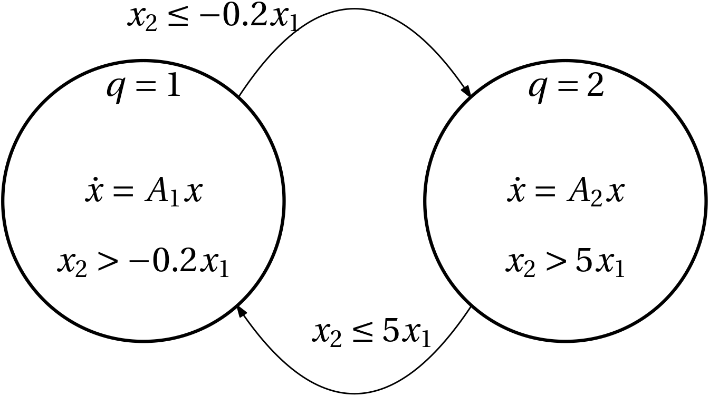
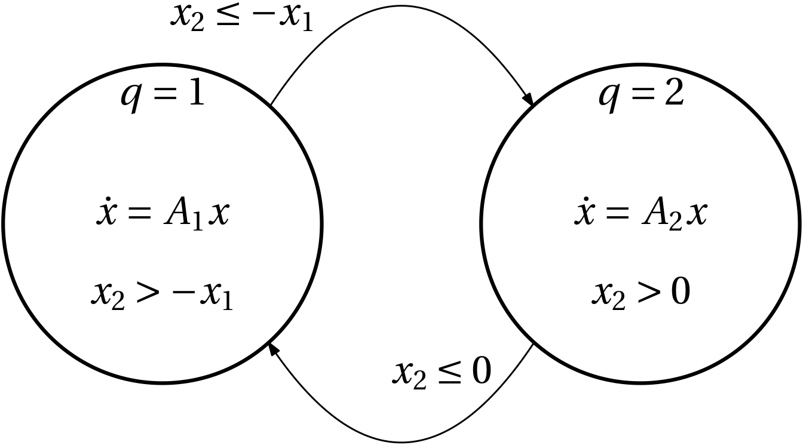

As we have recalled in the [recap section on stability of continuous dynamical systems](recap.qmd), stability is a property of an *equilibrium*. But what is an equilibrium of a hybrid systems? It turns out that the definition is not as straightforward as in the continuous case. It also depends on the chosen framework for modelling of hybrid systems.

## Equilibrium of a hybrid system modelled by a hybrid automaton

First, an equilibrium of a hybrid automaton is a point $\bm x_\mathrm{eq}$ in the continuous state space $\mathcal X\subset \mathbb R^n$.

:::{.callout-note}
Although we often assume the equilibrium at the origin, that is, $\bm x_\mathrm{eq} = \mathbf 0$, the assumption does not have to be invoked in order to provide the definition.
:::

We now consider a hybrid automaton for which the dynamics of each individual *mode* $q$ is given by $\dot{\bm x} = \mathbf f_q(\bm x)$. The *invariants* (or *domains*) of each mode are $\mathcal X_q, \, q=1, \ldots, m$.

The definition of the equilibrium $\bm x_\mathrm{eq}$ that is often found in the literature imposes these two conditions:

- $\mathbf 0 = \mathbf f_q(\bm x_\mathrm{eq})$ for all $q\in \mathcal Q$,
- the reset map $r(q,q',\bm x_\mathrm{eq}) = \bm x_\mathrm{eq}$.

The first condition states that the point in the continuous state space should qualify as an equilibrium for **each** mode. This might appear unnecessarily restrictive (what if the particular $\bm x_\mathrm{eq}$ is not an element of $\mathcal X_q$ for all $q$?) as we discuss later. But still, this definition appears in several resources. For example, in the definition 4.9 in the section 4.2 in @linHybridDynamicalSystems2022 or the definition 8.2 in the section 8.2 in (no longer available online) @lygerosHybridSystemsFoundations2020.  

The second condition states that the system can be regarded as resting at the equlibrium even if it jumps from one discrete state (mode) to another (while staying in the equilibrium continuous state).

## Equilibrium of a hybrid system modelled by hybrid equations

The state vector within this modelling framework is composed by both the discrete and continuous state variables. The two conditions for the equilibrium of a hybrid automata can be translated into the hybrid equation framework, which means that the equilibrium is not just a single point but rather a set of points.

:::{#exm-equilibrium-hybrid-equations}
## Equilibrium of a hybrid system modelled by hybrid equations
Consider a hybrid system modelled by hybrid equations, for which the state space is given by $\mathcal X = \{0,1\} \times \mathbb R$. The dynamics of the system is given by ... (tbd) <!-- #TODO. -->
:::

This makes the analysis significantly more challenging. Therefore, in our lecture we will only consider stability of hybrid automata. 

## Stability of a hybrid automaton

The equilibrium $\bm x_\mathrm{eq}=\mathbf 0$ is stable if for a given $\varepsilon > 0$ there exists $\delta > 0$ such that for all hybrid systems executions/trajectories starting at $(q_0,\bm x_0)$, 
$$
\|\bm x_0\| < \delta \Rightarrow \|\bm x(\tau)\| < \varepsilon, \; \forall \tau \in \mathcal{T},
$$
where $\tau$ is a hybrid time and $\mathcal{T}$ is the hybrid time domain.

## Asymptotic stability

The equilibrium is stable and furthermore we can choose some $\delta$ such that
$$
\|\bm x_0\| < \delta \quad \Rightarrow \quad \lim_{\tau\rightarrow \tau_\infty} \|\bm x(\tau)\| = 0,
$$
where $\tau_\infty<\infty$ if the execution is Zeno and $\tau_\infty=\infty$ otherwise.

## Is stability of the individual dynamics enough?

We answer this quations by considering the hybrid automaton in @fig-switching-between-stable-automaton.

{width=45% #fig-switching-between-stable-automaton}

The dynamics of the two models are given by linear state equations with the matrices
$$
A_1 = 
\begin{bmatrix}
-1 & -100\\ 10 & -1
\end{bmatrix}, \quad
A_2 = 
\begin{bmatrix}
-1 & 10\\ -100 & -1
\end{bmatrix}.
$$

We can examine the eigenvalues of the two matrices:
```{julia}
#| code-fold: false 
A1 = [-0.1  -100.0; 10.0 -1.0]
A2 = [-0.1  10.0;  -100.0 -1.0]

using LinearAlgebra
eigvals(A1), eigvals(A2)
```

and we can see that both matrices have only eigenvalues with negative real parts, which means that both modes are stable. However, as we can see in @fig-switching-between-stable-simulation, the hybrid automaton is unstable due to switching between the two modes. 

```{julia}
#| code-fold: true
#| fig-cap: "Simulation of a response of a given hybrid automaton to an initial condition. The response is unstable due to switching even though the two modes are stable"
#| label: fig-switching-between-stable-simulation
f1(x) = A1*x                
f2(x) = A2*x                

g12(x) = -0.2*x[1] - x[2]   # Function defining the guard g12(x) >= 0 for the transition from mode 1 to mode 2.
g21(x) = 5.0*x[1] - x[2]    # Function defining the guard g21(x) >= 0 for the transition from mode 2 to mode 1.

x0 = [1.0, 0.0]             # Initial state.
tspan = (0.0, 2.0)          # Time span.

# We need to introduce a discrete state variable (mode)
mutable struct Parameters   # Container for parameters just in case there are more in the future.
    mode::Int               # Discrete state (mode) of the system (1 or 2)
end

function f!(dx, x, p, t)    # RHS function for the ODE defining the dynamics of the hybrid system.
    dx .= p.mode == 1 ? f1(x) : f2(x) 
    return nothing
end

# Transitions for the discrete state variable (mode)
affect1!(integrator) = (integrator.p.mode = 2)
affect2!(integrator) = (integrator.p.mode = 1)

# Setting the initial mode based on x0
init_mode!(c, x, t, integrator) = (integrator.p.mode = g12(x) <= 0 ? 1 : 2) # Not general, but works for the initial state [0, 1].

using OrdinaryDiffEq

cb1 = ContinuousCallback((x,t,integrator)->g12(x), affect1!, nothing; initialize = init_mode!)
cb2 = ContinuousCallback((x,t,integrator)->g21(x), affect2!, nothing; initialize = init_mode!)
cb = CallbackSet(cb1, cb2)

prob = ODEProblem(f!, x0, tspan, Parameters(1))
sol = solve(prob, Tsit5(); callback = cb)

using CairoMakie
fig = Figure(size = (600, 600),fontsize=20)
ax = Axis(fig[1, 1], xlabel = "x₁", ylabel = "x₂")
lines!(ax, sol, idxs=(1, 2), color=:blue, label = "State")

x1min, x1max = extrema(sol[1, :])

lines!(ax, [x1min, 0.0], -0.2 .* [x1min, 0.0], color=:red, linestyle=:dash, label="g12(x) = 0")
lines!(ax, [0.0, x1max], 5.0 .* [0.0, x1max], color=:green, linestyle=:dash, label="g21(x) = 0")

axislegend(position = :rt)

fig
```


## Can the individual dynamics be unstable?

This question we also answer by means of an example. Consider the hybrid automaton in @fig-switching-between-unstable-automaton.

{width=45% #fig-switching-between-unstable-automaton}

The matrices that parameterize the linear state equations of the two modes are given by
$$
A_1 = 
\begin{bmatrix}
1 & -100\\ 10 & 1
\end{bmatrix}, \quad
A_2 = 
\begin{bmatrix}
1 & 10\\ -100 & 1
\end{bmatrix}.
$$

By examining the eigenvalues of the two matrices:
```{julia}
#| code-fold: false 
A1 = [1.0  -100.0; 10.0 1.0]
A2 = [1.0  10.0;  -100.0 1.0]

using LinearAlgebra
eigvals(A1), eigvals(A2)
```

we can conclude that both modes are unstable. However, as we can see in @fig-switching-between-unstable-simulation, the hybrid automaton is stable thanks to switching between the two modes.

```{julia}
#| code-fold: true
#| fig-cap: "Simulation of a response of a given hybrid automaton to an initial condition. The response is stable due to switching even though the two modes are unstable"
#| label: fig-switching-between-unstable-simulation
f1(x) = A1*x                
f2(x) = A2*x                

g12(x) = -1.0*x[1] - x[2]   # Function defining the guard g12(x) >= 0 for the transition from mode 1 to mode 2.
g21(x) =            -x[2]   # Function defining the guard g21(x) >= 0 for the transition from mode 2 to mode 1.

x0 = [1.0, 1.0]             # Initial state.
tspan = (0.0, 2.0)          # Time span.

# We need to introduce a discrete state variable (mode)
mutable struct Parameters   # Container for parameters just in case there are more in the future.
    mode::Int               # Discrete state (mode) of the system (1 or 2)
end

function f!(dx, x, p, t)    # RHS function for the ODE defining the dynamics of the hybrid system.
    dx .= p.mode == 1 ? f1(x) : f2(x) 
    return nothing
end

# Transitions for the discrete state variable (mode)
affect1!(integrator) = (integrator.p.mode = 2)
affect2!(integrator) = (integrator.p.mode = 1)

# Setting the initial mode based on x0
init_mode!(c, x, t, integrator) = (integrator.p.mode = g12(x) <= 0 ? 1 : 2) # Not general, but works for the initial state [1, 1].

using OrdinaryDiffEq

cb1 = ContinuousCallback((x,t,integrator)->g12(x), affect1!, nothing; initialize = init_mode!)
cb2 = ContinuousCallback((x,t,integrator)->g21(x), affect2!, nothing; initialize = init_mode!)
cb = CallbackSet(cb1, cb2)

prob = ODEProblem(f!, x0, tspan, Parameters(1))
sol = solve(prob, Tsit5(); callback = cb, abstol=1e-8, reltol=1e-8)

using CairoMakie
fig = Figure(size = (600, 600),fontsize=20)
ax = Axis(fig[1, 1], xlabel = "x₁", ylabel = "x₂")
lines!(ax, sol, idxs=(1, 2), color=:blue, label = "State")
scatter!(ax, x0[1], x0[2], color=:blue, marker=:circle, markersize=10, label = "Initial state")

x1min, x1max = extrema(sol[1, :])

lines!(ax, [x1min, 0.0], -1.0*[x1min, 0.0], color=:red, linestyle=:dash, label="g12(x) = 0")
hlines!(ax, [0.0], color=:green, linestyle=:dash, label="g21(x) = 0")

axislegend(position = :rt)

fig
```

The lesson learnt from these two examples is that when it comes to stability, hybrid systems can be rather non-intuitive. We need a systematic and rigorous framework for formulating and solving problems related to stability of hybrid systems. This is what we will discuss next.